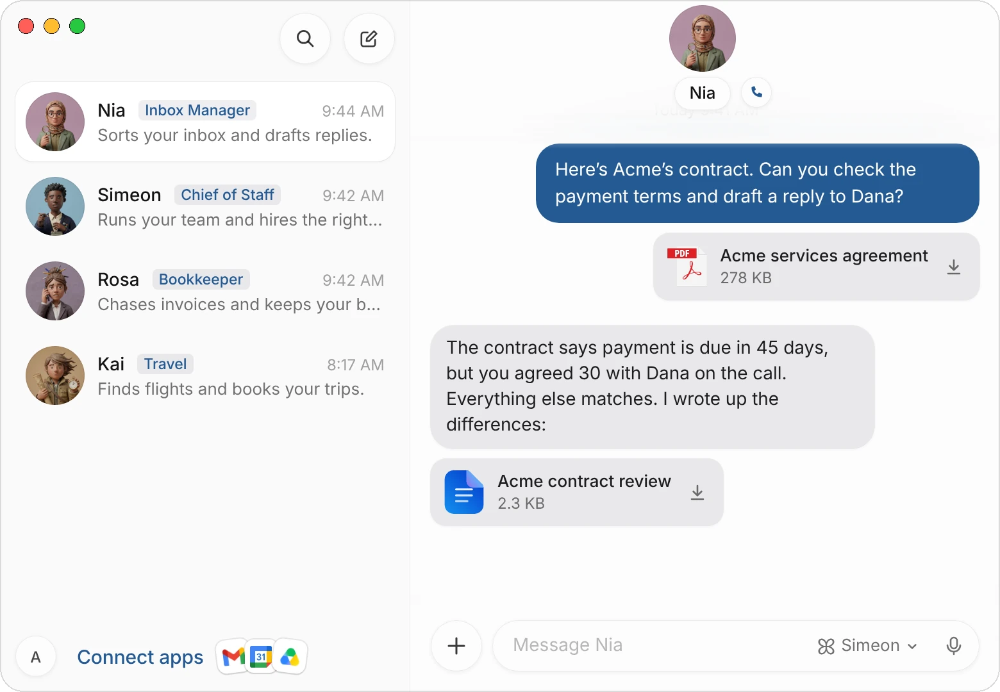
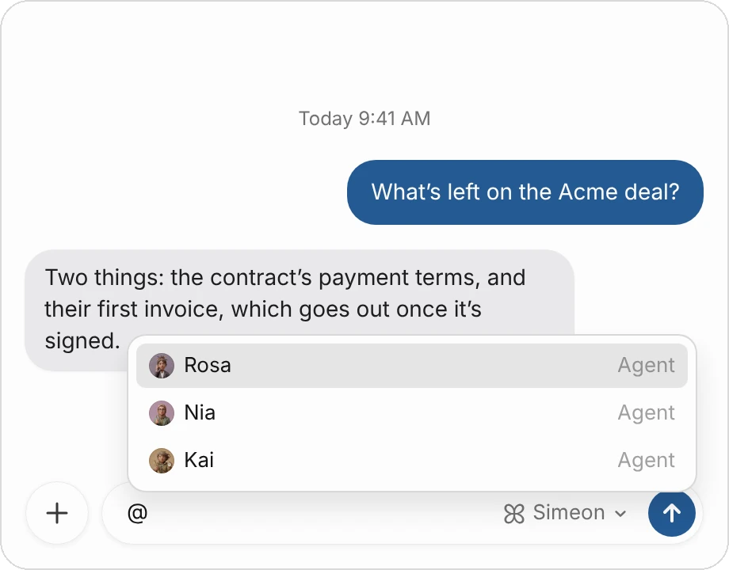
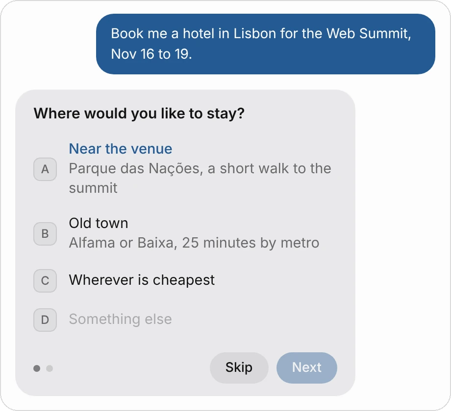
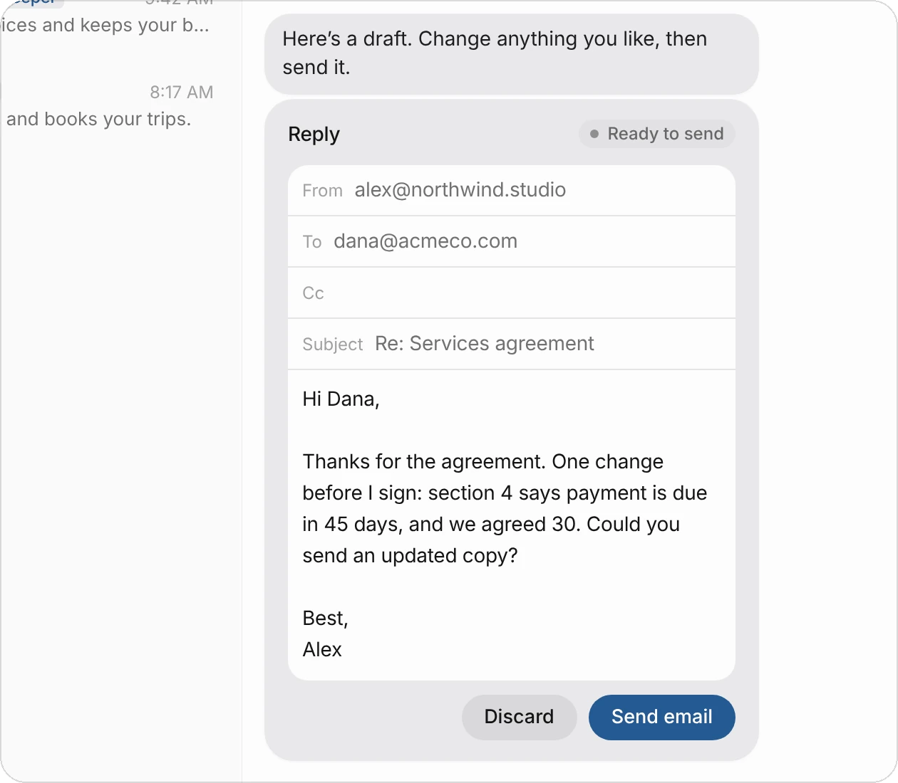
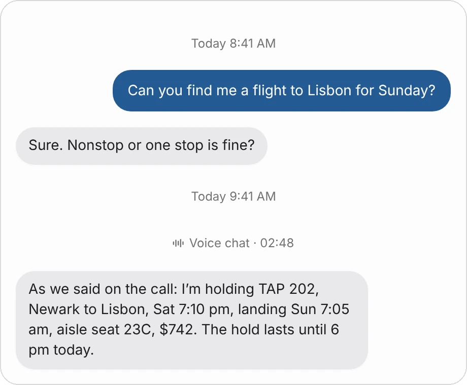
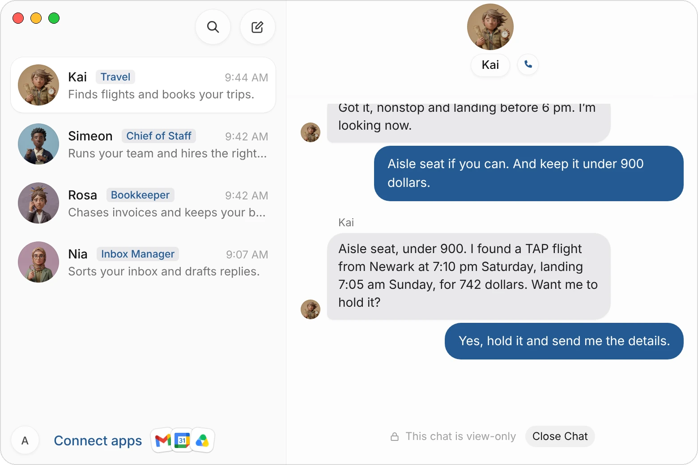
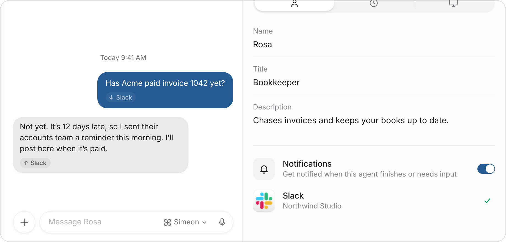

# Message and call your agents

Each agent has its own chat. You give it work there, it tells you what it's doing and what it found, and it asks you when it needs a decision. You can also call an agent and talk to it out loud, or let your team message it from Slack.

This page covers what you can send, what agents send back, voice calls and Slack.

| You want to | Do this |
|---|---|
| Give an agent work | Write or dictate in its chat. |
| Show it a document, a picture or a video | Attach the file to your message. |
| Point it to a teammate | Type @ and choose the agent. |
| Talk it through | Choose the phone button beside the agent's name. |
| Check something before it goes out | Edit the draft card the agent shows, then send it. |
| Let your colleagues ask it things | Connect the agent to Slack. |

## Write to an agent

1. Choose the agent in your list of chats.
2. Write in the message field at the bottom, which reads **Message** and the agent's name.
3. Press Return to send. Shift-Return starts a new line.

Say what you want done, what matters to you, and when the agent should check with you first:

> Find three venues in Austin for a 40-person offsite on March 12. Under $6,000, walking distance from downtown. Don't contact anyone yet, just send me the options.

The agent replies as it works and tells you when it's done. While it works, a dot on its row in your list shows it's busy. You can keep writing in the meantime.

To dictate instead of typing, choose the microphone at the right of the message field, speak, and choose it again to stop. What you said appears in the field for you to check before you send it.

:::tip
One clear outcome per message works best. If you have several unrelated tasks, give each to the agent whose job it is, or ask Simeon to hand them out.
:::

### React, reply and start a thread

Right-click a message (on iPhone, touch and hold it) for these:

| Action | What it does |
|---|---|
| **Add reaction** | Adds an emoji under the message. |
| **Reply** | Quotes the message in your next one, so it's clear what you're answering. |
| **Start a thread** | Opens a thread on that message, to keep a side topic out of the main chat. |
| **Copy** | Copies the message's text. |

## Send files, pictures and videos

Choose **+** beside the message field to attach a file, or drag files onto the chat, or paste a picture. You can add up to six files to one message, each up to 25 MB, or 200 MB for a video. Add a line about what you want, then send.

Agents read documents and spreadsheets, look at pictures, and can say what happens in a short video. Files the agent makes come back as cards with the file's name, its kind and its size.

{c=#af8fa0 ar=16/11}

Choose a file's name to open it, or the arrow to save it to your computer.

## Mention a teammate

Type @ in the message field to bring another agent into what you're writing.

1. Type **@**. A list of your agents opens over the field.
2. Keep typing to narrow it, then choose the agent (or use the arrow keys and Return).
3. The agent's name goes into your message as a pill with its face.

{c=#89acbc w=100 ar=6/5}

The agent you're writing to then knows exactly which teammate you mean, and can pass work to them:

> Ask @Rosa to send Acme their first invoice once the contract is signed.

The same list offers your routines and your connected apps. Type / instead to point the agent to one of its skills.

In any message, choose a mention pill to open that agent's chat.

## Answer an agent's questions

When only you can decide something, such as your budget, who a gift is for or which of two options you prefer, the agent asks with a question card instead of guessing.

{c=#a5835f w=100 ar=1/1}

1. Choose an answer, or choose **Something else** and type your own.
2. If the card has several questions, the dots show how many. Choose **Next** to go on, **Back** to change an answer, or **Skip** to leave one out.
3. Your answers go to the agent together, and it carries on.

If you'd rather explain in your own words, write a message instead. To decline a question, choose **Skip**. See [Approvals, security, and privacy](/docs/approvals) for the other cards agents use to ask you.

## Edit a draft before it's sent

When an agent writes an email or a Slack message for you, it can show it as a draft card first. Drafting sends nothing.

{c=#af8fa0 edge=right w=100 ar=19/20}

1. Read the draft. For an email you can change **To**, **Cc**, **Subject** and the message; for a Slack message, the message.
2. Choose **Send email** (or **Send message** for Slack) to send it as it is now, or **Discard** to drop it.
3. The card says **Sending…**, then **Sent**. If sending fails, the card comes back so you can try again.

:::note
The agent sends the draft the best way it has: through an app you've connected, such as Gmail, Outlook or Slack, or on its own computer. See [Connect apps](/docs/connectors).
:::

## Call an agent

You can talk to any agent out loud, the way you'd call a colleague. It answers in its own voice, in a sentence or two, and hands anything that needs doing to its work in the background while you keep talking.

1. Open the agent's chat.
2. Choose the phone button beside its name at the top. On a Mac, a small call window opens at the top right of your screen and stays over your other windows.
3. Talk. Ask for something, change your mind, or ask how it's going at any time.
4. Use **Mute** to mute your microphone and **Transcript** to see what you've both said. Choose **End** to hang up.

> Kai, I need to be in Lisbon by Sunday evening. Nonstop if you can, aisle seat, under $900.

The call stays in the chat as a line with its length. The agent's work carries on in the chat after you hang up.

{c=#a5835f w=100 ar=9/8}

Choose the call's line to read the whole conversation. It's view-only; choose **Close Chat** to go back.

{c=#a5835f edge=right ar=6/5}

| Good to know | |
|---|---|
| **Length** | A call lasts up to 30 minutes, and ends after about 25 seconds of silence. |
| **Cost** | Calls use your Simeon credits, by the second. If you're out of credit, the call says **Out of credit for calls**. See [Plans and billing](/docs/billing). |
| **Recording** | Your voice isn't kept after the call. The words of the call are saved in the chat. |
| **One at a time** | You can be on one call at a time. Choosing the phone button again brings the call forward. |

## Talk to an agent from Slack

Connect an agent to your Slack workspace, and people there can message it directly or mention it in a channel. It answers in Slack under its own name.

1. Open the agent's profile: choose its face or name at the top of its chat.
2. Under **Notifications**, find **Slack** and choose **+**.
3. Slack opens in your browser. Pick your workspace and allow access.
4. Back in Simeon, the Slack row shows your workspace's name once it's connected.

{c=#8f7f8d ar=16/10}

In Slack, message the Simeon app, or invite it to a channel and mention it. The agent only hears messages sent to it directly or that mention it. What's said in Slack also shows in the agent's chat in Simeon, tagged **Slack**, so you can follow along.

To disconnect, choose **⋯** on the Slack row, then **Disconnect**.

## Common questions

### Does the agent keep working if I close the app?

Yes. Your agents run on your cloud computer, not on your own computer or phone, so they carry on with the work while the app is closed. You'll get a notification when an agent finishes or needs you. To turn that off for one agent, use the **Notifications** switch in its profile.

### Can I send a message while the agent is busy?

Yes. Write as you normally would. Your message goes to the agent like any other, and it takes it into account.

### What can I attach?

Documents, spreadsheets, presentations, PDFs, pictures and videos: up to six files in one message, each up to 25 MB, or 200 MB for a video. For a video, keep it short: the agent watches it to say what happens.

### Can my colleagues use my agents?

Through Slack, yes: anyone in the workspace can message the agent you connected. They see its answers in Slack; they don't see your chats in Simeon.

### Why didn't the agent send the email itself?

Anything that goes out under your name comes to you as a draft card first. Nothing is sent until you choose **Send email**. See [Approvals, security, and privacy](/docs/approvals).

## Related pages

:::cards
- [Create and manage agents](/docs/agents) Hire agents, give each a job, and change its profile.
- [The agent's computer](/docs/computer) Watch an agent work, or take control.
- [Connect apps](/docs/connectors) The apps your agents send and read through.
- [Simeon for iPhone](/docs/iphone) Message and call your agents from your phone.
:::
