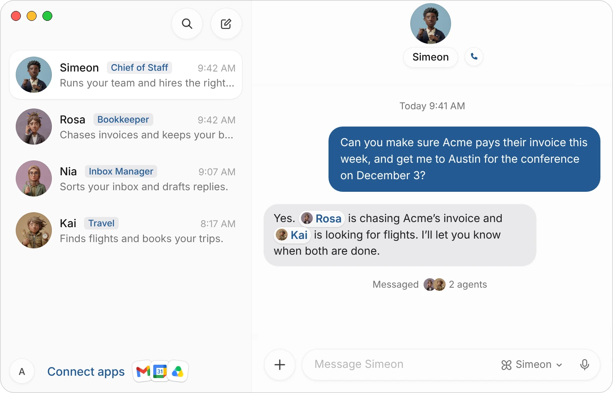
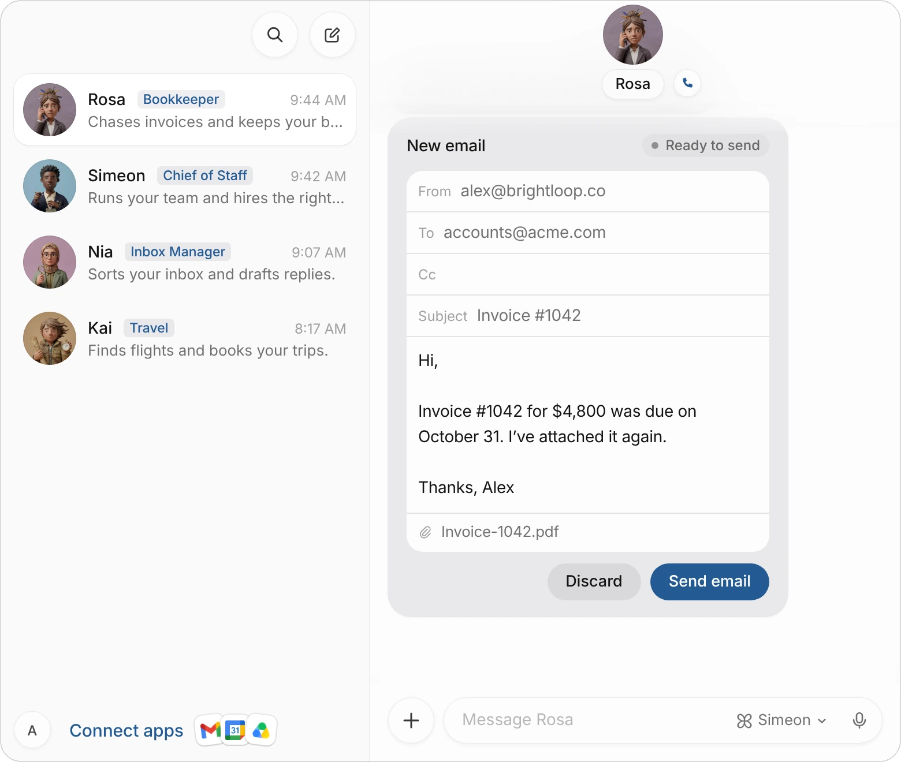

# Simeon

Simeon is a team of AI agents you hire for real jobs: an inbox manager, a bookkeeper, a travel agent, a recruiter. Each agent has a name, a face, a title that says what it does, and a chat with you. It works on your team's cloud computer, on a desktop of its own, and in the apps you connect.

This page covers what's in Simeon, how work moves through your team, what agents can and can't do without you, and what you need to start. To set it up, go to [Get started](/docs/get-started).

| Part | What it is |
|---|---|
| **Simeon** | Your chief of staff and the first agent on your team. He hires the other agents, briefs them and passes work to the right one. |
| **Agents** | Teammates with one job each. You give them work in their chat; they message each other to hand work on. See [Create and manage agents](/docs/agents). |
| **The cloud computer** | Where your agents work: a browser, files and a desktop for each agent. You can watch an agent work or take over. See [The agent's computer](/docs/computer). |
| **Connected apps** | Gmail, Google Calendar, Slack, Notion, QuickBooks, HubSpot and more than 200 others. You sign in once, on the app's own page. See [Connect apps](/docs/connectors). |
| **Routines** | Work an agent does on a schedule or when something happens, even while your Mac is closed. See [Routines](/docs/routines). |
| **The apps** | Simeon for Mac, and [Simeon for iPhone](/docs/iphone). Your agents and chats are the same on both. |

## How work moves through your team

You give work to an agent by messaging it: type, dictate, or call it and talk. You can ask the agent whose job it is, or ask Simeon and let him pass it on.

> Can you make sure Acme pays their invoice this week, and get me to Austin for the conference on December 3?

Simeon answers in a line, sends each part to the agent whose job it is, and shows the messages he sent under his reply:

{c=#89acbc ar=16/11}

Each agent then works in its own chat: it reports progress there, asks you questions with cards you answer in a click, and tells you when it's done. Choose **Messaged 2 agents** to read what Simeon asked them.

When there's no one on your team for a job, Simeon hires someone: he picks a name and a title, writes a description and a brief, and the new agent starts on the work. See [Hire an agent through Simeon](/docs/agents#hire-an-agent-through-simeon).

## What agents can do

An agent does the work itself, in your real tools, instead of handing you a draft to finish:

- **Email and calendar.** Sort an inbox, draft replies, book meetings, prepare you for them.
- **Money.** Match payments to invoices, chase late ones, file receipts, keep the books up to date.
- **Research and writing.** Look things up across the web, compare options, write documents and reports.
- **Websites without a connector.** Sign in, fill in forms, download files, using the browser on its computer. When a site needs a password or a code, the agent asks you, and you type it in a secure form it never sees.
- **Travel and shopping.** Find flights and show you the options on a card, book the one you choose, and buy what you asked for once you allow it.
- **Recurring work.** A [routine](/docs/routines) runs on a schedule, such as every weekday at 8 a.m., or when something happens, such as a mention in Slack.

Agents keep what they learn about you and your work, such as how you like a report laid out or which clients matter most, so you explain less over time.

## What stays in your hands

Agents work on their own, but some things wait for you:

| What | How you decide |
|---|---|
| **An email or Slack message in your name** | It comes as a draft card. You can edit it, then choose **Send email** or **Discard**. Nothing is sent until you do. |
| **A payment** | It comes as a checkout card with what you're buying and the total. Nothing is paid until you choose **Allow**; with Link, you also approve it in the Link app. |
| **A password or code** | The agent asks with a card. You type it into a secure form, the computer fills it into the page, and the agent never sees what you typed. |
| **A new app** | The agent asks with a **Connect** card. You sign in on the app's own page, and you can turn the app off or remove it at any time. |

{c=#8f7f8d edge=right ar=6/5}

Agents don't send email or messages you didn't ask for, whether from a routine, a web page or another agent's request. If you discard a draft, the agent doesn't send it another way. See [Approvals, security, and privacy](/docs/approvals).

Your data stays in your account, and it's never used to train AI models.

## What you need

| | |
|---|---|
| **A Mac** | With Apple silicon, on macOS 15 or later. [Download Simeon for macOS](https://api.simeonlabs.com/desktop/download/mac). |
| **An account** | Sign up with your email, Google or Apple. |
| **A plan** | Standard is $30 a month, Pro $100 and Max $200. Each starts with a 7-day free trial. Plans differ in how much your agents can do each week. See [Plans and billing](/docs/billing). |

You don't need API keys or accounts with AI companies: the models your agents use are included in your plan.

## Common questions

### Does Simeon keep working when my Mac is closed?

Yes. Your agents work on the cloud computer, not on your Mac, so routines run on schedule while your Mac is asleep or closed. The computer sleeps when nobody uses it and wakes when there's work.

### Can several agents work at the same time?

Yes. Each agent has its own chat, its own job and its own desktop on the computer, and they hand work to each other.

### What does an agent remember?

Its job, your preferences and what it has learned about how you work. To change what it knows, tell it in its chat or edit its description in its profile.

### Can an agent use any website?

Most of them, in the browser on its computer, including services with no connector. When a site asks for a sign-in, a code or a check that you're human, the agent asks you to fill it in, or you take over the computer and do it yourself.

### Which languages do agents speak?

Your agents write to you, and to each other, in the language your app uses. Change it in **Settings** › **General** › **Language**.

### How much does Simeon cost?

Standard is $30 a month, Pro $100 and Max $200, each with a 7-day free trial. See [Plans and billing](/docs/billing).

## Related pages

:::cards
- [Get started](/docs/get-started) Install the app, meet Simeon and give your first agent a task.
- [Use cases](/docs/use-cases) Ready-made teams and first tasks you can copy.
- [Create and manage agents](/docs/agents) Hire agents, set their jobs and manage your team.
- [Approvals, security, and privacy](/docs/approvals) What agents ask before acting, and how your data is kept.
:::
