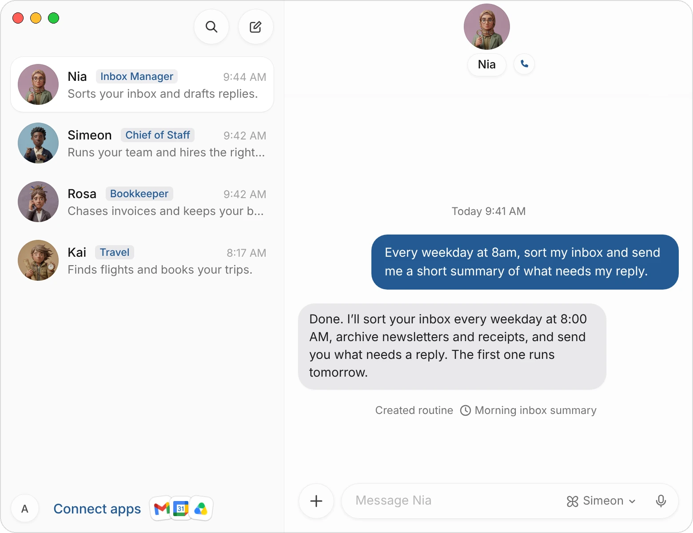
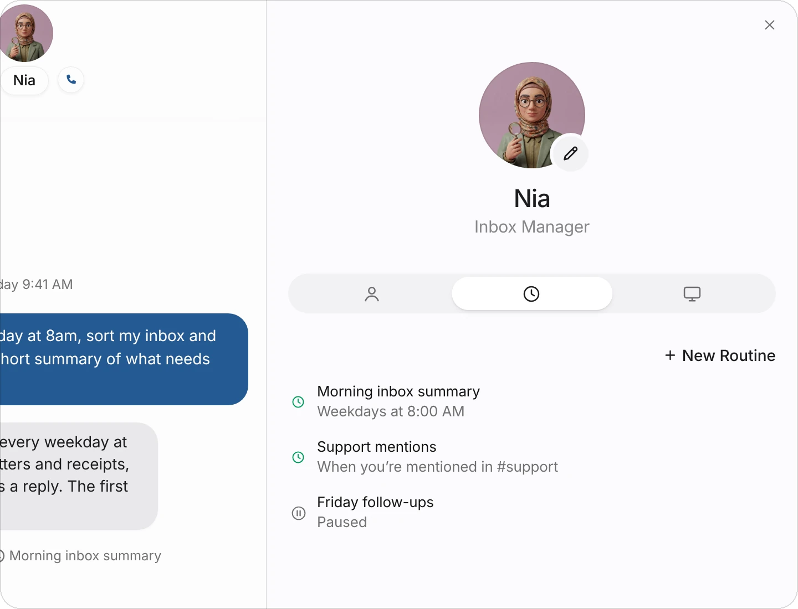
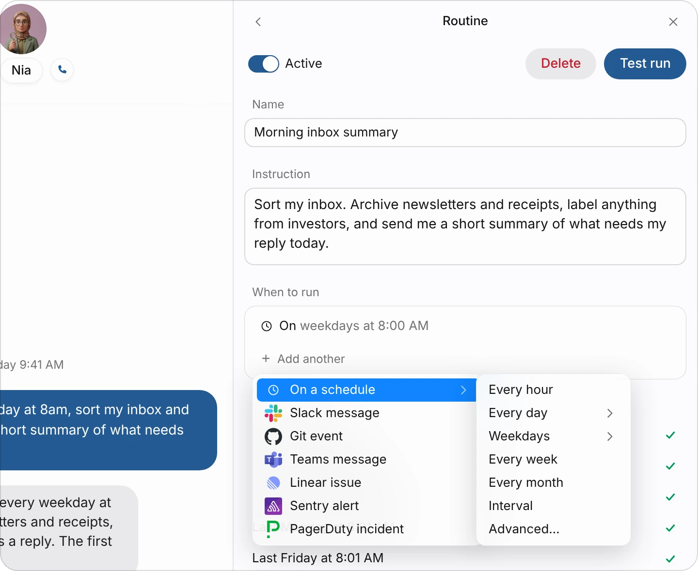
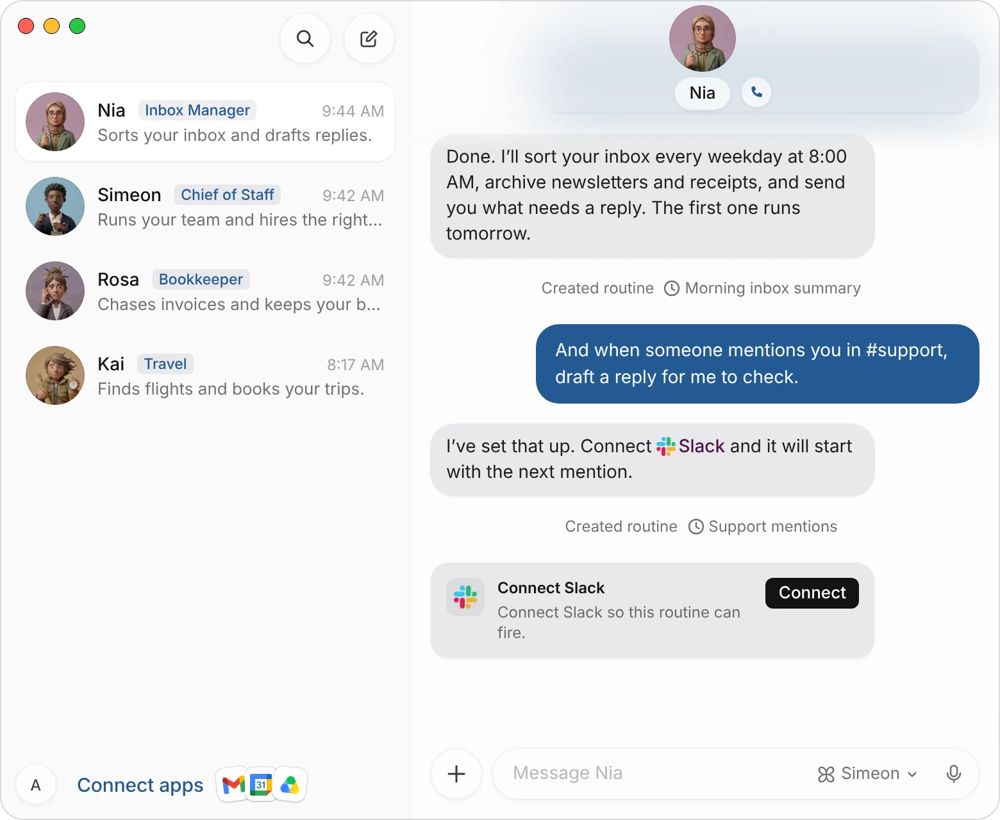
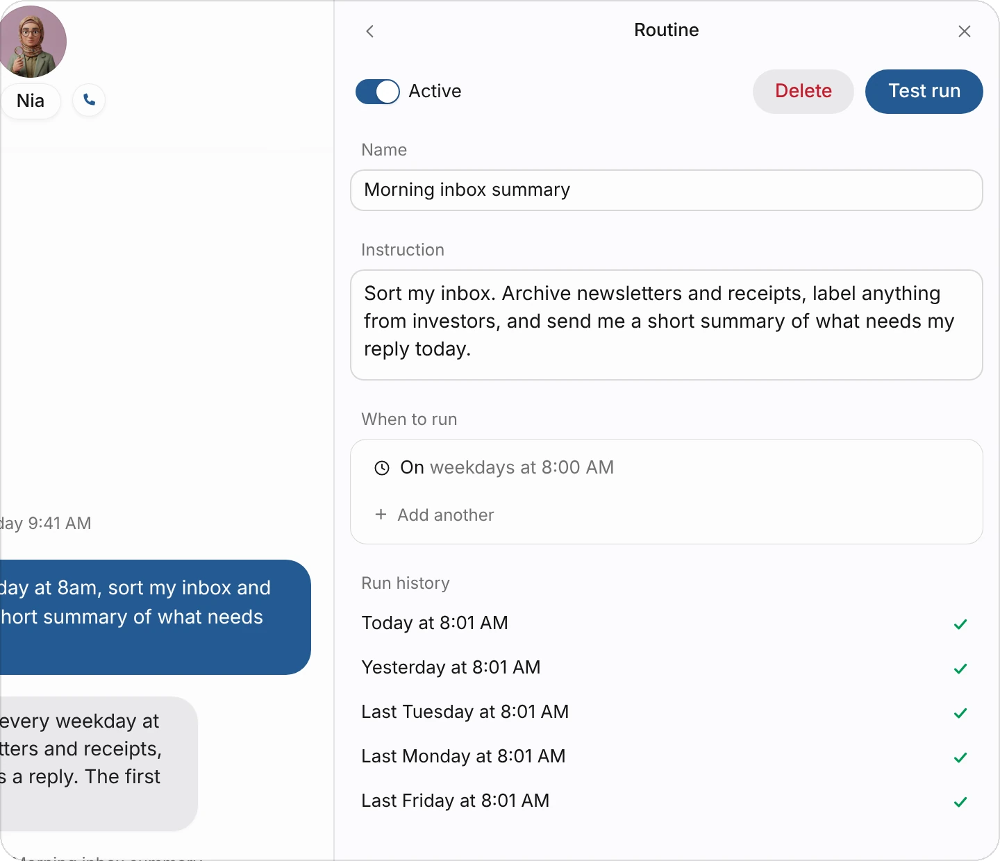
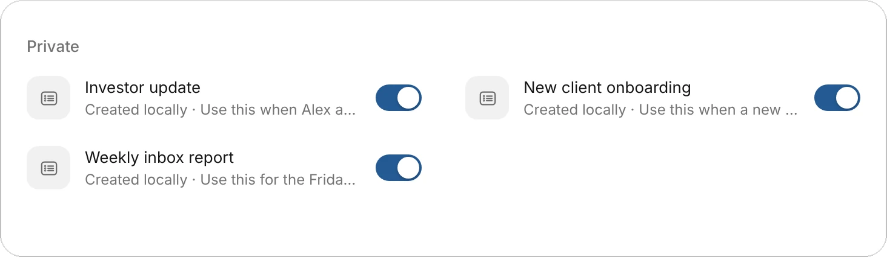
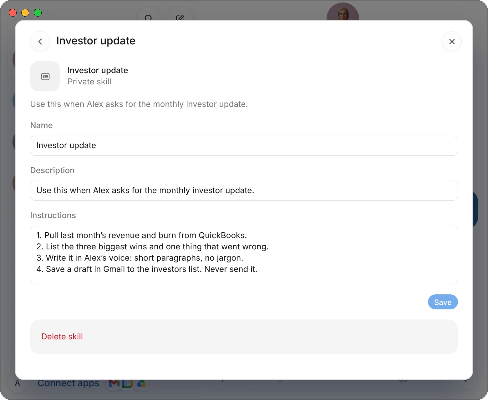

# Routines and skills

A routine is a task an agent runs on its own: every weekday at 8 AM, on the first of the month, or each time someone mentions it in Slack. Routines are kept on Simeon's side and run on your team's cloud computer, so they keep running while your Mac is closed.

A skill is a way of doing something that an agent keeps and reuses, such as your investor update format or your steps for a new client.

This page covers how to set up routines, how to change them, and how skills work.

| What a routine has | What it's for |
|---|---|
| **Name** | How it shows in the agent's list, such as Morning inbox summary. |
| **Instruction** | What the agent does each time it runs, in your words. |
| **When to run** | A schedule, a Slack message, or several of these. |
| **Active** | Whether it runs. Turn it off to pause the routine without deleting it. |
| **Run history** | When it ran, and whether each run finished. |

## Set up a routine in the chat

The quickest way is to ask the agent whose job it is.

1. Open the agent's chat.
2. Say what to do and when:

> Every weekday at 8am, sort my inbox and send me a short summary of what needs my reply.

3. The agent sets up the routine and says when it will run. A line under its reply shows **Created routine** and the routine's name.

{c=#af8fa0}

Choose the routine's name on that line to open it and check what the agent saved. To change a routine later, you can also ask in the chat:

> Move my morning summary to 7:30, and skip Fridays.

## Set up a routine yourself

1. Open the agent's profile: choose its face or name at the top of its chat.
2. Choose the **Routines** tab, the clock.
3. Choose **New Routine**.
4. Give it a **Name** and an **Instruction**: what the agent should do each time it runs.
5. Under **When to run**, choose **Add trigger** and pick when it runs (see the next section).

{c=#af8fa0 edge=right ar=8/7}

The routine is created once it has a name, an instruction and a trigger. After that, a field is saved as soon as you leave it. An agent can have up to 50 routines.

## Choose when it runs

In the routine, **When to run** lists its triggers. Choose **Add trigger** (or **Add another**) and pick one:

{c=#af8fa0 edge=right ar=1/1}

| Choice | Runs |
|---|---|
| **Every hour** | Each hour, at the minute you pick. |
| **Every day** | Each day, at the time you pick. |
| **Weekdays** | Monday to Friday, at the time you pick. |
| **Every week** | On the day of the week and at the time you pick. |
| **Every month** | On the day of the month and at the time you pick. |
| **Interval** | Every so many minutes, hours or days. |
| **Advanced…** | Choose months, days and times together: for example, at 9 AM and 4 PM on Mondays and Thursdays, or every 30 minutes between 9 AM and 6 PM. |
| **Slack message** | When a message, a reaction or a mention of the agent arrives in a Slack channel. See [Run a routine from Slack](#run-a-routine-from-slack). |

To change a trigger, choose its line: its settings open under it, such as **Weekdays** at **8:00 AM**. To remove one, point at its line and choose the **×** at its end. A routine can have up to eight triggers, and it runs when any of them fires.

:::note
**Add trigger** also lists Git, Teams, Linear, Sentry and PagerDuty events. Those don't start routines yet. Use a schedule or a Slack message.
:::

## Run a routine from Slack

A routine can start when something happens in a Slack channel: a new message, a reaction, or a mention of the agent.

1. Ask the agent, and name the channel:

> When someone mentions you in #support, draft a reply from our help docs for me to check.

2. The first time, the agent shows a **Connect Slack** card. Choose **Connect**, pick your workspace on Slack's page and allow Simeon.
3. The card says **Connected**. The routine starts with the next matching message.

{c=#af8fa0}

You can set the same thing up yourself: **Add trigger** › **Slack message**, then choose the channel, what to listen for, and words the message must contain if you like.

:::tip
For a private channel, invite the Simeon app to it in Slack first. A routine can't hear a private channel it hasn't been invited to.
:::

## Change, test and pause a routine

Open a routine from the agent's **Routines** tab, or from its name in the chat.

{c=#af8fa0 edge=right ar=1/1}

| Control | What it does |
|---|---|
| **Active** | Turn it off to pause the routine. It stays in the list as **Paused** until you turn it back on. |
| **Test run** | Runs the routine now, once, without changing its schedule. |
| **Delete** | Deletes the routine at once, without a question. |
| **Run history** | Its last runs, newest first: a tick for one that finished, a mark for one that didn't. Point at a failed run to read why. |

A run that doesn't finish tries again at the routine's next time.

## Write a good routine

- **Start with a task that already worked in the chat.** Once the result is what you want, ask the agent to do it on a schedule.
- **Say what to do with the result:** send it to you, post it in Slack, or save it in Google Drive.
- **Say when to stay quiet.** "Only message me if something needs my reply" keeps an empty run from sending you a message.
- **Approvals still apply.** A routine that would send something under your name, or spend money, waits for your OK like any other task. See [Approvals, security, and privacy](/docs/approvals).

| Instead of | Write |
|---|---|
| Check email | Every weekday at 8 AM, archive newsletters and receipts, label anything from investors, and send me what needs my reply today. |
| Do the books | On the 1st of each month, match last month's Stripe payouts against QuickBooks and list anything that doesn't match. |
| Watch Slack | When someone mentions you in #support, draft a reply from our help docs and show it to me before posting. |

## Skills

A skill is a set of instructions an agent saves and uses again: your investor update, your steps for a new client, the checks you want before an invoice goes out. Each skill has a name, a line on when to use it, and the steps.

### Save a skill

When a task has gone the way you want, ask the agent to keep it:

> Save how you just wrote the investor update as a skill, and use it every month.

The agent saves the skill with a line that says when it applies, such as "Use this when Alex asks for the monthly investor update." From then on, it follows the skill whenever that comes up.

### See and change an agent's skills

1. Open the agent's chat.
2. Choose **Connect apps** at the bottom of your list of chats, then **Yours**.
3. Under **Private**, you see that agent's skills. Turn a skill's switch off to stop the agent using it.

{c=#af8fa0 ar=16/5}

4. Choose a skill to open it. Change its **Name**, **Description** or **Instructions**, then choose **Save**. **Delete skill** removes it.

{c=#af8fa0}

:::note
A skill belongs to the agent that saved it. To give another agent the same way of working, ask that agent to save it too.
:::

### Skills and routines together

A routine says when to do something; a skill says how. A routine can name a skill:

> Every first Monday of the month at 9am, write the investor update using your Investor update skill, and save it as a draft in Gmail.

## Common questions

### Do routines run when my Mac is closed?

Yes. Routines are kept on Simeon's side and run on your team's cloud computer, not on your Mac.

### Where do I see what a routine did?

In the agent's chat: it works there and posts what it found or did. The routine's **Run history** shows when each run happened and whether it finished.

### I don't want a routine any more. Should I delete it?

If you might need it again, turn off **Active** to pause it. **Delete** removes it at once and doesn't ask first.

### Can a routine use my apps?

Yes, any app you've connected, as in any other task. See [Connect apps](/docs/connectors).

## Related pages

:::cards
- [Create and manage agents](/docs/agents) Give each agent its job.
- [Connect apps](/docs/connectors) The apps routines work in.
- [Approvals, security, and privacy](/docs/approvals) What still waits for your OK.
- [The agent's computer](/docs/computer) Where the work happens.
:::
