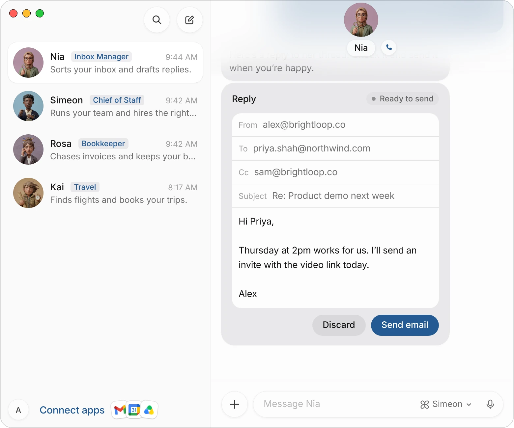
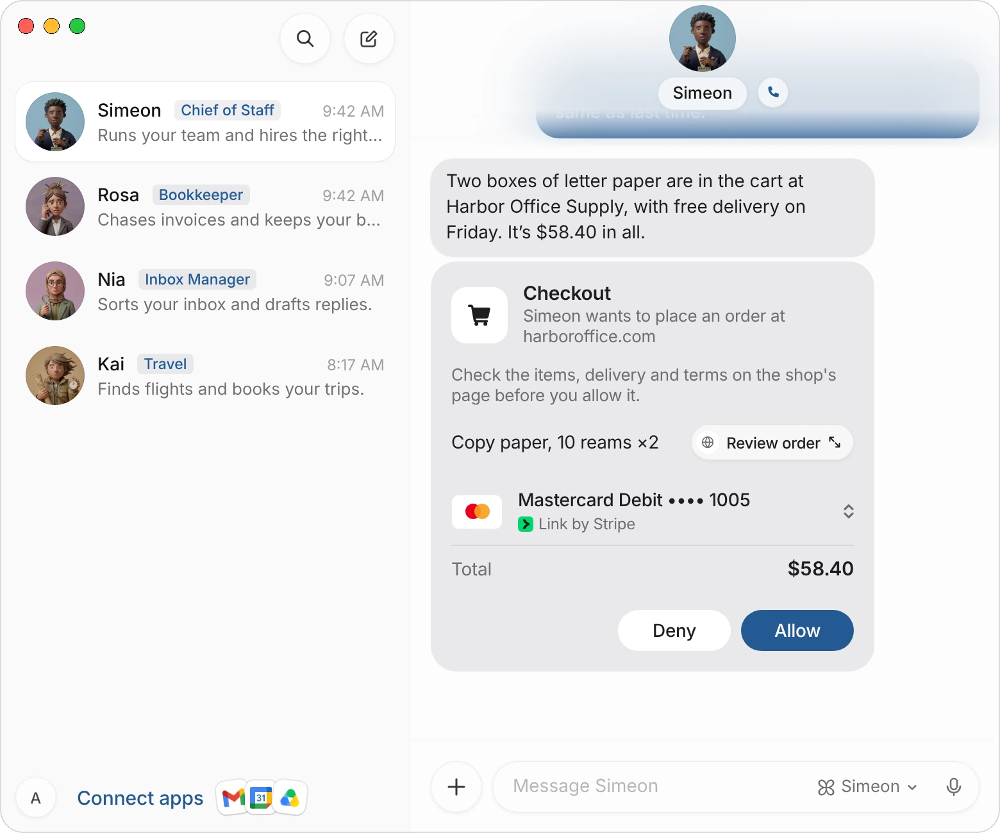
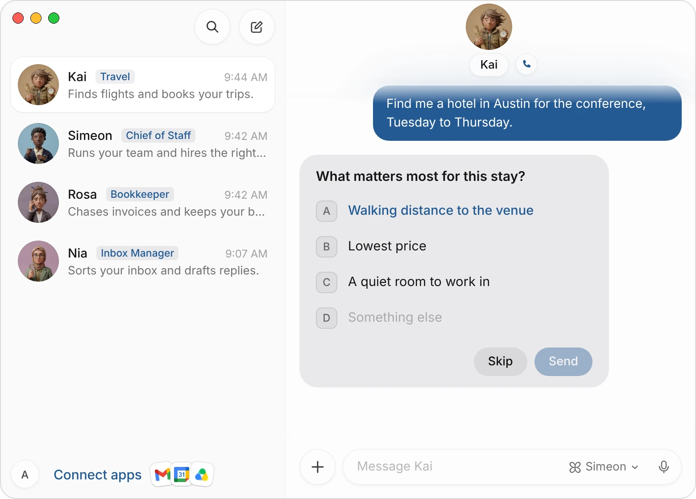

Your agents work on their own, but some things wait for you: an email that goes out under your name, a payment, an answer only you know, a password. For each of these the agent puts a card in its chat and stops until you answer it.

This page covers each card and what happens when you answer, how purchases are approved, how agents use your Mac, and how your data is kept.

| Card | When you see it | Your answer |
|---|---|---|
| **Email or Slack draft** | An agent wrote something that would go out under your name. | **Send email** (or **Send message**), or **Discard** |
| **Checkout** | An agent has an order ready to pay. | **Allow** or **Deny** |
| **Question** | The agent needs something only you know, like a budget or a date. | Pick an answer, write your own, or **Skip** |
| **Secrets** | A task needs an API key or another secret. | **Save securely** or **Not now** |
| **Sign-in** | A page on the agent's computer needs a login or a code. | **Open** the secure form and **Fill in**, or **Not now** |
| **Your turn on the computer** | A step only you can do, like a passkey or a captcha. | **Take over**, then **I'm done**, or **Skip** |
| **Run commands on your computer** | An agent wants to run a command or open files on your Mac or PC. | **Always allow**, **Allow once** or **Never** |

Cards look and work the same on the Mac, on iPhone and on the web. When an agent stops on a card, you get a notification that it needs you, with what it's asking.

## Emails and messages

An email or a Slack message that would go out under your name comes as a draft card first. Nothing is sent until you send it.

1. Ask an agent to write or answer something:

> Can you reply to Priya at Northwind? Tell her Thursday at 2pm works for the demo.

2. The agent puts the draft in its chat. An email shows **From**, **To**, **Cc**, **Subject**, the message and any attached files; a reply to a thread says **Reply** at the top.
3. Change anything you like on the card: who it goes to, the subject, the words. **From** is the mailbox it goes from, Gmail or Outlook, and can't be changed on the card.
4. Choose **Send email**. The card says **Sending…**, then **Sent**.

{c=#af8fa0 w=100 ar=6/5}

**Discard** throws the draft away, and the agent takes it as a no: it won't send it another way or write it again unless you ask. If an email can't be sent, the card becomes editable again and the agent tells you why.

A Slack message works the same way: the card shows the **Workspace**, who it goes **To** and the **Thread**, and you choose **Send message**.

:::note
An agent sends without a card only when you've asked it, in that chat, to send that exact message to those people. It never sends email or messages because a routine, a web page or another agent asked it to.
:::

## Purchases

Agents can buy things for you with Link or Shop Pay. Add one first in **Settings › Wallet**, under **Payment methods**; it opens the app's page in Connect apps, where you sign in with the app's own sign-in. Every purchase waits for your approval.

1. Ask for what you need:

> We're out of printer paper. Order two boxes, same as last time.

2. When there's a choice to make, the agent shows what it found as product cards: the picture, the price and the store. Open one to see why it fits, and choose **Buy with** and the agent's name, or **View at** to see it on the store's site.
3. The agent fills the cart and the delivery details on the shop's own site, on its computer, and stops at the last step before paying.
4. A **Checkout** card comes in the chat: what it's buying, the card that pays and the **Total**.
5. Choose **Review order** to open the agent's computer on the checkout page and check the items, the delivery and the terms.
6. To pay with another card, choose the card's row and pick one under **Pay with**.
7. Choose **Allow** and confirm with Face ID or Touch ID. On the web, you confirm in a window that names the amount and the site. **Deny** stops the purchase and the agent is told.

{c=#89acbc w=100 ar=6/5}

Once you allow it, the card follows the order. Link may ask you to approve the purchase in the Link app as well: the card then says **Approve with Link**, with **Get the Link app** and **Open Link**. When the order is placed, the card says **Ordered** with the order number.

| The card says | What it means |
|---|---|
| **In progress** | Simeon is asking Link to pay. |
| **Approve with Link** | Link is waiting for you to approve the purchase in the Link app. |
| **Approved · placing your order** | The agent is placing the order on the shop's site. |
| **Ordered** | The order went through. The order number is under it. |
| **Denied**, **Expired**, **Canceled** | Nothing was paid. |
| **Didn't go through** | The order failed. The line under it says why. |

How the money is kept safe:

- **Each Link purchase gets its own one-time card**, made for that amount. Your real card number is never used at the shop.
- **The agent never sees a card number.** Simeon types the one-time card into the checkout itself, only on that shop's site, and the agent is told only which fields were filled.
- **The total is checked against the checkout page** before the card is shown. If they don't match, nothing is asked of Link and the agent is told the page's total.
- **Link limits what agents can spend:** $500 a purchase, $500 a day and $20,000 in 30 days. A total over a limit is refused before a card is shown.

With Shop, a Shopify store's checkout is paid through Shop with the card you pick, and the card ends on **Ordered** with the order number. At any other store, Shop asks you to approve a one-time card in the Shop app, and the card says **Approve it in the Shop app** until you do.

:::tip
Purchases with Link work for accounts in the US and Canada. Add or remove cards in the Link app or at link.com: the checkout card lists the ones it lets agents use.
:::

## Questions

When an agent needs something only you know, such as who a gift is for, your budget or a date, it asks with a question card before it searches or picks.

{c=#a5835f w=100 ar=16/11}

- Choose an answer and it's sent at once. The agent's suggested answer is shown in blue.
- **Something else** lets you write your own answer, then **Send**.
- With several questions in one card, the card moves to the next as you answer, and sends all your answers together. **Back** goes to the previous one.
- **Skip** tells the agent you'd rather not answer. It carries on without it.

A question stays open until you answer or skip it, so you can come back to it later.

## Secrets, sign-ins and your turn on the computer

Agents never ask for a password, a code or a key in the chat. They ask with a card instead:

- **Secrets.** For an API key or a token, a card under **Secrets** says what it's for. Paste it and choose **Save securely**: it's stored securely and never shown to your agent.
- **Sign-ins.** When a page needs a login, a one-time code or an address, a card opens a secure form. You type there and choose **Fill in**, and Simeon types it into the page. What you type isn't shown to the agent. A login you saved in the Credentials Store is filled without a card, and with 1Password connected, a card offers **Fill with 1Password**, confirmed with Face ID or Touch ID. See [Credentials Store and secure sign-in](/docs/credentials).
- **Your turn on the computer.** For a step the form can't do, like a passkey, a captcha or signing in with Google, the card says **Action needed**. Choose **Take over** to work on the agent's computer, then **I'm done**. **Skip** tells the agent to carry on without that step. See [The agent's computer](/docs/computer).

**Not now** on any of these cards is a no, and the agent hears it right away.

## Agents on your Mac

An agent can run commands and open files on your Mac, for example to work in a project on your computer. The first time it needs to, a card over the message field asks: **Allow Simeon and all agents to run commands on your local computer?**

- **Allow once** lets this one command run.
- **Always allow** lets agents run commands on this Mac without asking.
- **Never** stops agents from using this Mac.

To change your answer later, open **Settings › Computer** and, under **Your Computer**, set **Execution on Local Computer** to **Always allow**, **Ask every time** or **Never allow**. **Ask every time** is the default. The same setting is in the Windows app.

:::note
Whatever you choose, agents can't read the folders where your Mac keeps passwords and browser sign-ins, such as your keychain and Chrome's profile.
:::

## Assistants you've connected

Assistants you've connected to Simeon, like Claude Code or Dots, can see what your agents are waiting on and answer an agent's question for you. Purchases, 1Password logins, secrets, sign-in forms and Credentials Store entries can only be answered by you, in the Simeon app. See [Simeon Network](/docs/network).

## Your data

| Your data | How it's kept |
|---|---|
| **Encrypted** | Connections between your devices and our servers are encrypted, and the logins of your connected apps are kept only for your account. |
| **Kept apart** | Each customer's agents and cloud computers are separate from every other customer's. |
| **Not used for training** | We never use your content to train AI models. The AI providers we use work under business terms that don't let them train on what we send. |
| **Where it's stored** | In the United States and the European Union. |
| **Deleted when you ask** | Deleting your account deletes your agents, their computers and files, your chats, memory and routines, and disconnects your apps. |

The full details are in the [Privacy Policy](/privacy).

## Common questions

### What happens if I don't answer a card?

The agent waits. A card ends the agent's turn, so it doesn't carry on around it or ask again. Answer whenever you're ready: the agent's row in your chat list shows what it's asking.

### Can a routine or another agent approve a purchase?

No. Only you can allow a checkout, in the Simeon app on your Mac, Windows PC, iPhone or the web. Other agents and the assistants you've connected can't answer it.

### I chose Allow by mistake. Can I stop the purchase?

If the card still says **Approve with Link**, decline the purchase in the Link app and nothing is paid. Once the card says **Ordered**, the order is placed: cancel it with the shop, as you would any order.

### Can an agent send a message without the draft card?

Only when you've told it, in that chat, to send that exact message to those people. To make sure every email waits for you, add it to the agent's description: "Never send an email without my OK."

## Related pages

:::cards
- [Credentials Store and secure sign-in](/docs/credentials) Logins, contact details and sign-ins filled with Face ID.
- [The agent's computer](/docs/computer) Watch an agent work, or take control.
- [Connect apps](/docs/connectors) Link, Shop, Gmail and the other apps your agents use.
- [Plans and billing](/docs/billing) Plans, weekly usage and extra credits.
:::
