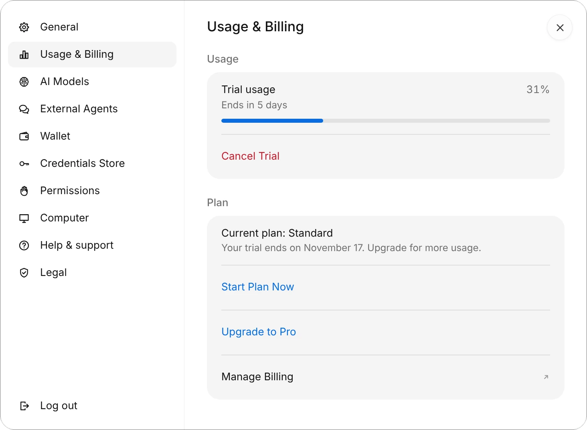
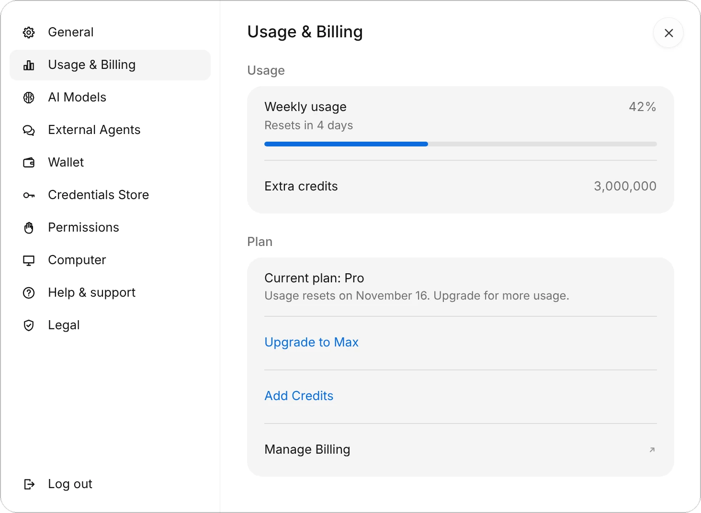
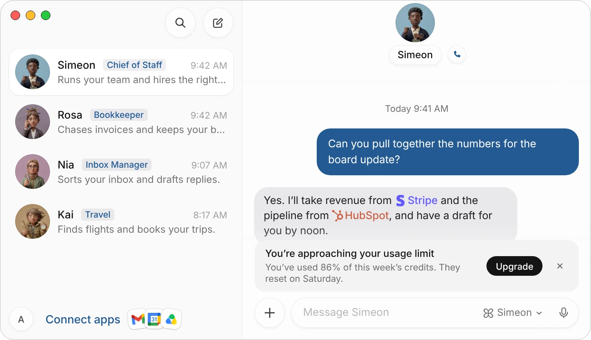

Every plan gives you the whole product: your agents, their cloud computers, connected apps, routines, Slack and Discord, and voice calls. Plans differ in how much work your agents can do each week.

This page covers the plans, the free trial, how usage is counted, extra credits, and how to change or cancel your plan on the web and on iPhone.

| Plan | Price | Credits each week |
|---|---|---|
| **Standard** | $30 a month | 10,000,000 |
| **Pro** | $100 a month | 35,000,000, 3.5 times Standard |
| **Max** | $200 a month | 90,000,000, 9 times Standard, and earliest access to new products |

Every plan lets you have up to 50 agents. Your plan sets how much they can do each week, not how many there are. See [Pricing](/pricing).

## Start your free trial

Every account gets one 7-day free trial, with one week of Standard credits, whichever plan you choose. How it starts depends on where you sign up.

**On iPhone.** The trial starts when you first sign in, with no card. When the 7 days or the credits run out, the app shows the plans so you can choose one.

**On the web or the Mac:**

1. Go to [app.simeonlabs.com/billing](https://app.simeonlabs.com/billing), or choose **Start Free Trial** in the Mac app, and sign in.
2. Under **Choose your plan**, choose **Start your Standard Trial** (or Pro, or Max).
3. Add a card on Stripe's checkout page. Nothing is charged today.
4. The page says **You're all set!** Open Simeon and sign in with the same account.

When the 7 days end, your plan starts and your card is charged, unless you cancel the trial first.

{c=#89acbc w=100 ar=5/4 edge=right}

During a trial you can:

- **Start Plan Now** to end the trial today and start your plan with a fresh week of credits. You pay for the plan today.
- **Upgrade to Pro** (or Max) to change the plan your trial turns into. The trial goes on.
- **Cancel Trial** so your card isn't charged and the trial doesn't turn into a plan.

:::note
The trial is one per person, and on the web one per card. A plan you buy after it starts right away, with no second trial.
:::

## How usage is counted

Your agents' work uses credits: every message they think through, every page they read, every step on their computer. Each plan gives you a number of credits a week.

- **Your week** starts on the day your plan started, not on a Monday, and resets every seven days. A renewal always starts a fresh week.
- **Unused credits** don't carry over to the next week.
- **When the week's credits run out**, your agents wait until they reset. To keep going sooner, upgrade or add extra credits.

To see where you are, open **Settings › Usage & Billing** on the Mac, the web or iPhone. You can also choose the account button at the bottom of your list of chats: **Weekly usage** shows the share used and when it resets.

{c=#89acbc w=100 ar=5/4 edge=right}

| On the page | What it shows |
|---|---|
| **Weekly usage** | The share of this week's credits used, and when they reset. The bar turns red past 90%. |
| **Extra credits** | The extra credits you have left, when you've bought some. |
| **Current plan** | Your plan, and the date your usage resets or your trial ends. |
| **Upgrade to** | Moves you to the next plan up. |
| **Add Credits** | Buys extra credits (on a paid plan, on the web). |
| **Manage Billing** | Opens Stripe's billing page: your card, invoices, receipts and cancelling. |

### When you're near the limit

From 80% of the week's credits, and again from 95%, a line over the message field tells you how much is used and when it resets. Its button upgrades your plan, or adds credits on Max. Close it with the **×** and it stays closed until the next step.

{c=#89acbc w=100}

When the credits are used up, the line says **This week's credits are used** and when they reset.

:::tip
If an agent uses credits very fast in a short time, it pauses and carries on as the hour passes. This stops a task that's gone wrong from using a whole week in one go.
:::

## Extra credits

Extra credits let your agents keep working after the week's credits run out, without changing plan.

- A pack is **3,000,000 credits for $10**. You can buy up to 10 packs at a time.
- They're used only after your week's credits are used up, and they **last 12 months**.
- You can buy them on a paid plan, not during a trial.

To buy them, choose **Add Credits** in **Settings › Usage & Billing**, or **Add credits** on [app.simeonlabs.com/billing](https://app.simeonlabs.com/billing), and pay on Stripe's page. If your plan is billed through Apple, buy them on the web.

:::note
Per dollar, each plan gives more credits than extra credits do. If you buy packs most weeks, a bigger plan costs less.
:::

## Change your plan

On the web and the Mac, choose **Upgrade to Pro** (or Max) in **Settings › Usage & Billing**, or open [app.simeonlabs.com/billing](https://app.simeonlabs.com/billing) and choose **Adjust your plan**. A page says what the change does and costs before you choose **Confirm**.

| Change | When it takes effect | What you pay |
|---|---|---|
| **Upgrade** | Today, with a fresh week of credits. | The new plan's price, less the unused time on your current plan, charged now. |
| **Downgrade** | At your next renewal. You keep your current plan until then. | The smaller plan's price, from the renewal. |
| **During a trial** | The trial goes on, and the new plan starts when it ends. | Nothing until the trial ends. |

A downgrade waiting for your renewal shows on the billing page with **Keep** and your current plan's name, to cancel the switch.

## Plans on iPhone

On iPhone, plans are bought with Apple's in-app purchase, at the same monthly prices.

1. Open **Settings › Usage** and choose **Choose a plan**, or choose the button on the line over the message field.
2. Pick **Standard**, **Pro** or **Max**.
3. Choose **Subscribe** and confirm the purchase with Apple.

Apple bills the plan and emails your receipts. To change or cancel it, choose **Manage Subscription** in **Usage & Billing**, or open the iPhone's **Settings › your name › Subscriptions**. On a new iPhone, **Restore Purchases** finds a plan bought with the same Apple Account.

A plan bought on the web works on iPhone too, and a plan bought on iPhone works on the Mac and the web. Extra credits aren't sold in the iPhone app; buy them on the web.

## Run your agents on your own AI account

If you have a ChatGPT or Claude plan, or an API key from an AI provider, your agents can use it. Open **Settings › AI Models**, which lists every provider you can connect, choose **Connect** next to yours and sign in, then choose its model in the menu on the message field.

Your agents' work on your own account uses no Simeon credits. If your account reaches its plan's limit, your agents carry on with Simeon's models, on your credits, until it resets. Voice calls, dictation and video still use your Simeon credits, and you still need a Simeon plan for your agents' cloud computers. With an API key, the provider bills the calls on your key.

## Cancel

- **Plan bought on the web or the Mac:** choose **Manage Billing** in **Settings › Usage & Billing**, or **Manage billing on Stripe** on [app.simeonlabs.com/billing](https://app.simeonlabs.com/billing), and cancel on Stripe's page. Your plan runs until the end of the period you paid for.
- **Plan bought on iPhone:** open the iPhone's **Settings › your name › Subscriptions** and cancel there.

:::warning
Deleting your Simeon account doesn't cancel a plan billed through Apple. Cancel it in the iPhone's **Settings › your name › Subscriptions**.
:::

## Common questions

### What uses the most credits?

Long work on the agent's computer, such as filling in forms or going through a website page by page, uses more than answering in the chat. Routines that run often add up over a week.

### My payment didn't go through. What happens?

Your agents, chats and computers stay, but you can't send messages until the card is updated. A line over the message field says so, with **Update card**. For a plan billed through Apple, update your payment method in your Apple Account.

### Can I pay yearly?

Plans are billed monthly.

### Do I get a receipt?

For a plan on the web, your invoices and receipts are under **Manage Billing**, on Stripe's page. For a plan on iPhone, Apple emails them.

## Related pages

:::cards
- [Approvals, security, and privacy](/docs/approvals) What your agents ask before they act.
- [Simeon on iPhone](/docs/iphone) Your agents on your phone.
- [Create and manage agents](/docs/agents) Add agents and give each one a job.
- [Routines](/docs/routines) Work that runs on a schedule.
:::
