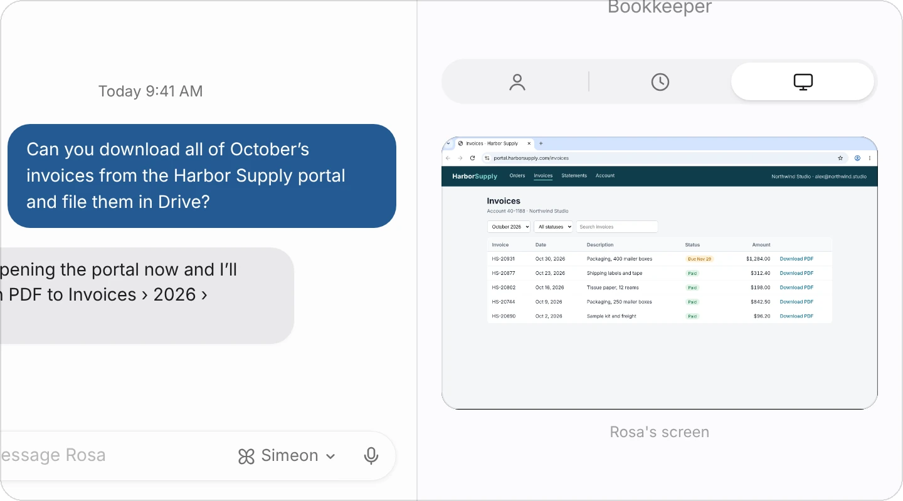
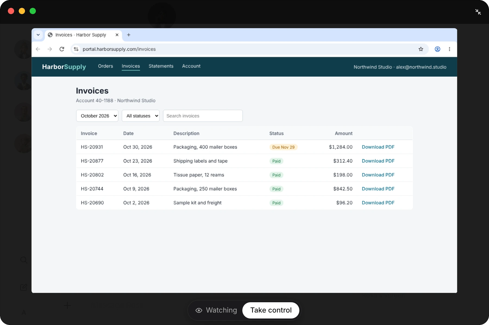
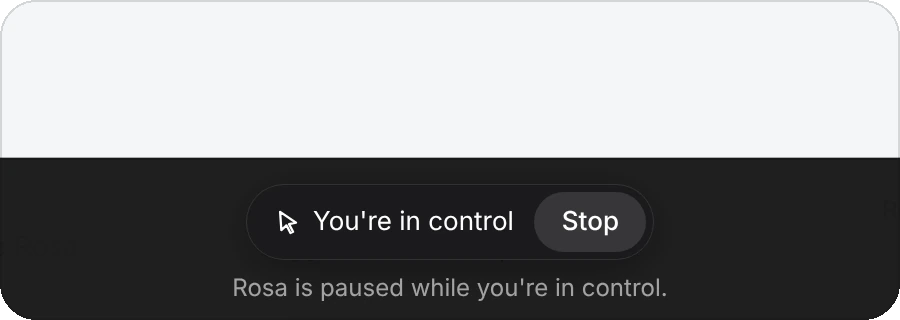
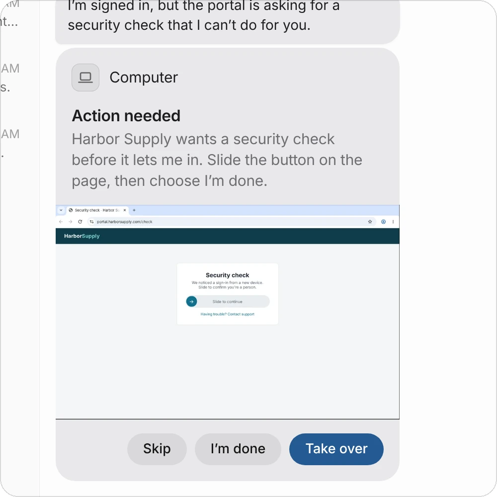
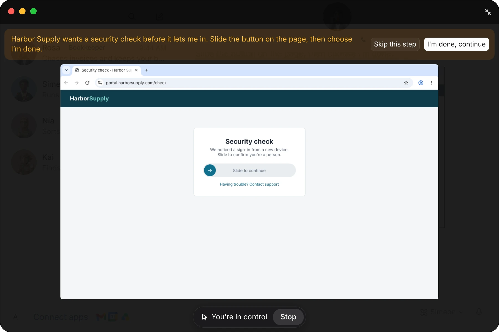
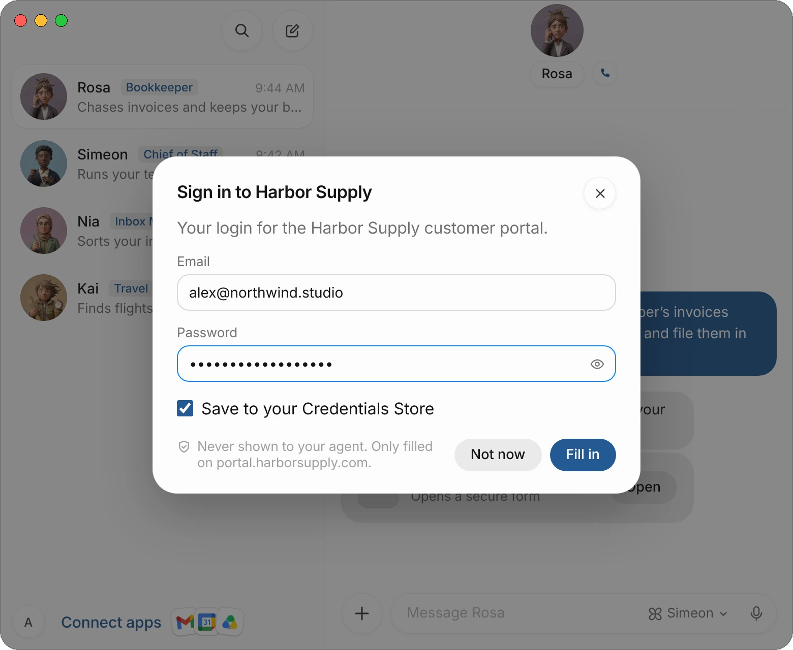

Your agents work on a computer in the cloud that belongs to your account. Each agent has its own desktop there, with a Chrome browser and its own files, so it can open websites, sign in, fill in forms and download files the way you would. That's how work gets finished in your real tools instead of ending as a suggestion in the chat.

This page covers how to watch an agent's screen, take control of it, answer when an agent needs you at the computer, and let agents use your Mac.

| What you can do | Where |
|---|---|
| See what an agent is doing | The **Computer** tab of its profile. |
| Watch its screen full size | Choose the screen in the **Computer** tab. |
| Do a step yourself | **Take control** under the screen. |
| Answer when the agent needs you | The **Computer** card in its chat, or a secure form. |
| Let agents use your Mac | **Settings** › **Computer**. |

## See an agent's screen

1. Open the agent's profile: choose its face or name at the top of its chat.
2. Choose the **Computer** tab, the screen icon at the right.
3. The agent's screen shows live, with its name under it.

{c=#8f7f8d edge=right ar=16/10}

If the computer is asleep or starting, the tab says so instead of showing the screen. Opening the full view (below) starts it; that can take a little while.

## Watch it full size

Choose the screen in the **Computer** tab. It opens over the whole window.

{c=#8f7f8d ar=11/9}

The view opens in **Watching**, so you can't click on the agent's screen by accident while it works. If the agent has sent helpers to work on other screens at the same time, their screens show under the main one; choose one to watch it.

Choose the arrows at the top right to close the view.

## Take control

When there's a step you'd rather do yourself, such as a payment page or a choice on a website, take over the computer.

1. In the full view, choose **Take control** under the screen.
2. If the agent was working, it pauses at once, so it never fights you for the mouse. The view says so: **Rosa is paused while you're in control.**
3. Use the screen as you would your own computer. Your keyboard types on it, and on a Mac you can copy and paste between your Mac and the agent's computer.
4. When you're done, choose **Stop**, or close the view. The agent picks up from where things stand, including anything you changed.

{c=#8f7f8d w=100 ar=12/5}

:::tip
You don't need to explain what you did. When you hand the computer back, the agent looks at the screen and carries on from there.
:::

## When an agent needs you at the computer

Some steps only you can do: a security check that asks you to prove you're a person, a sign-in through another company's account or a passkey, a page the agent can't get past. The agent then stops and asks you in the chat with a **Computer** card. It shows what the agent needs and a picture of the screen.

{c=#8f7f8d edge=right w=100 ar=20/21}

1. Choose **Take over** (or the picture). The computer opens with you already in control, and the agent's instruction across the top.
2. Do the step on the page.
3. Choose **I'm done, continue**. The view closes and the agent carries on.

{c=#8f7f8d ar=11/9}

| Button | What it does |
|---|---|
| **Take over** | Opens the computer in control, to do the step. |
| **I'm done** | Tells the agent the step is done, without opening the computer. |
| **Skip** | Declines the step. The agent carries on without it, or tells you what it couldn't do. |

The card then shows how it ended: **Done**, **Answered**, **Skipped** or **Canceled**. The same request also shows over the screen in the agent's **Computer** tab, as **Needs your attention**.

## Type a sign-in or a code in a secure form

When a page only needs something typed, such as your email and password, a one-time code or an address, the agent doesn't hand you the whole computer. It sends a form in the chat, and the computer types what you enter into the page.

1. In the chat, find the card, such as **Sign in to Harbor Supply**, and choose **Open**.
2. Type in the form. A password or a code is hidden; choose the eye to see it.
3. For a sign-in, leave **Save to your Credentials Store** on to keep the login for next time, or turn it off.
4. Choose **Fill in**. The computer types it into the page, and the card then shows whether each field went in.

{c=#8f7f8d ar=16/11}

What you type goes only into that one site, and the agent never sees it: it learns only which fields went in. Choose **Not now** to decline.

If you've connected 1Password and the login is there, the agent asks to fill it from 1Password instead, and you confirm with Touch ID or Face ID. For the logins you keep in Simeon, see [Credentials Store](/docs/credentials).

:::note
Agents don't ask for passwords or codes in a message. If one ever does, don't type it in the chat: use the form, or take control and type it on the page yourself.
:::

## Let agents use your Mac

An agent can also run commands and work with files on your Mac, not only on its cloud computer, if you allow it. This works while Simeon is open and signed in on your Mac.

When an agent needs your Mac and you haven't allowed it for good, a card above the message field asks: **Allow Simeon and all agents to run commands on your local computer?**

| Choice | What it does |
|---|---|
| **Allow once** | Allows this one command or file. |
| **Always allow** | Allows agents to use your Mac from now on, without asking. |
| **Never** | Agents can't use your Mac until you change it in Settings. |
| **✕** | Declines this one request. |

The choice applies to Simeon and every agent. To change it later:

1. Open **Settings** and choose **Computer**.
2. Under **Your Computer**, set **Execution on Local Computer** to **Always allow**, **Ask every time** or **Never allow**.
3. To withdraw the permissions you gave with **Allow once**, choose **Forget** beside **Commands Allowed Once**.

If you're on a team whose admin limits this, the menu says the most your team allows. See [Approvals, security, and privacy](/docs/approvals).

## When your Mac is closed

Your agents' computer is in the cloud, so their work and their [routines](/docs/routines) carry on while your Mac is asleep or closed. The computer sleeps when nothing is running and wakes when an agent or a routine needs it.

## If the computer doesn't respond

**Settings** › **Computer** shows the state of your agents' computer under **Agents' Computer**:

| What you see | What to do |
|---|---|
| **Connected** | Nothing: it's working. |
| **Connecting…** | Wait a moment; it's starting or waking up. |
| **Can't reach it** | Check your internet connection. If it stays that way, choose **Recover Simeon's Computer**. |
| **A new version is available** | Choose **Update** to update the computer. |

**Recover Simeon's Computer** recreates the computer and reconnects. Your agents, files and logins are kept.

## Common questions

### Can the agent see my screen?

Not on its own. Agents work on their own desktops on your cloud computer. They use your Mac only if you allow it, as described in [Let agents use your Mac](#let-agents-use-your-mac).

### Do agents share one computer?

They share your account's cloud computer, but each agent works on a desktop of its own, so two agents don't type into the same page.

### What happens to the agent's work if I take control?

It pauses where it was. When you choose **Stop** or close the view, it looks at the screen and continues from there.

### Where are the files an agent downloads?

On its computer. When a file is for you, the agent sends it in the chat, where you can open or save it, or puts it where you asked, such as a Google Drive folder.

## Related pages

:::cards
- [Message and call your agents](/docs/messaging) Chat, voice calls, files and drafts.
- [Credentials Store](/docs/credentials) Logins, cards and contact details your agents can fill in.
- [Approvals, security, and privacy](/docs/approvals) What agents ask before they act.
- [Simeon for iPhone](/docs/iphone) Watch and take over the computer from your phone.
:::
