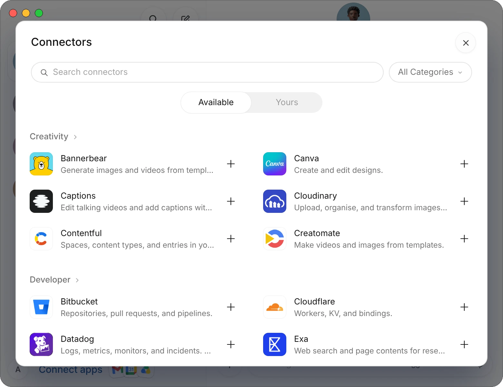
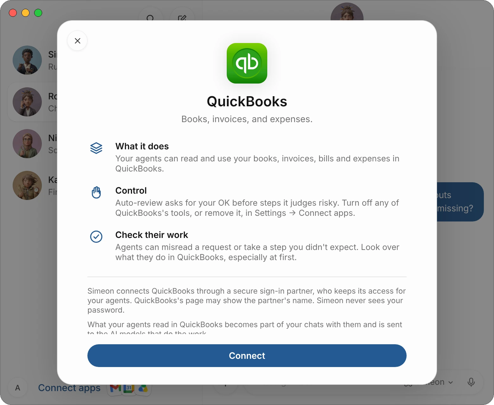
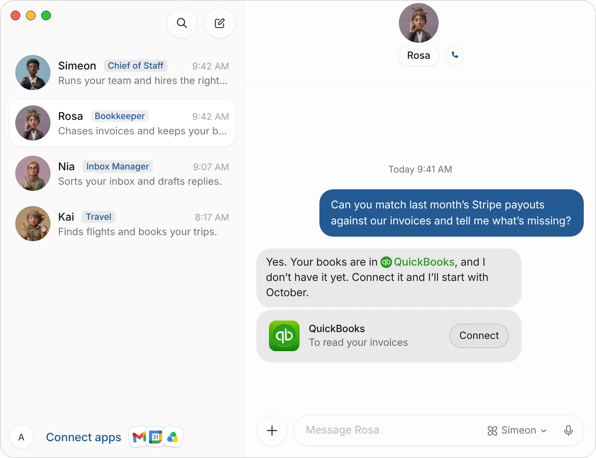
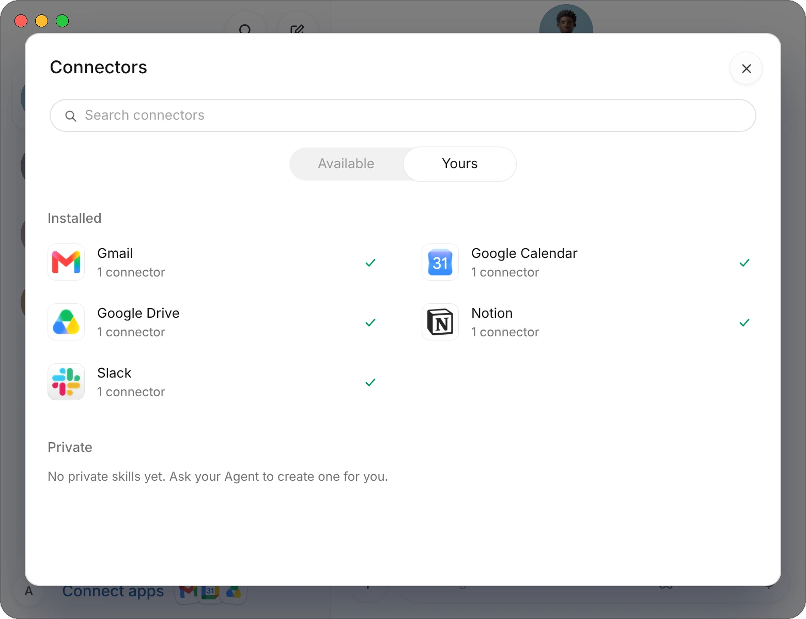
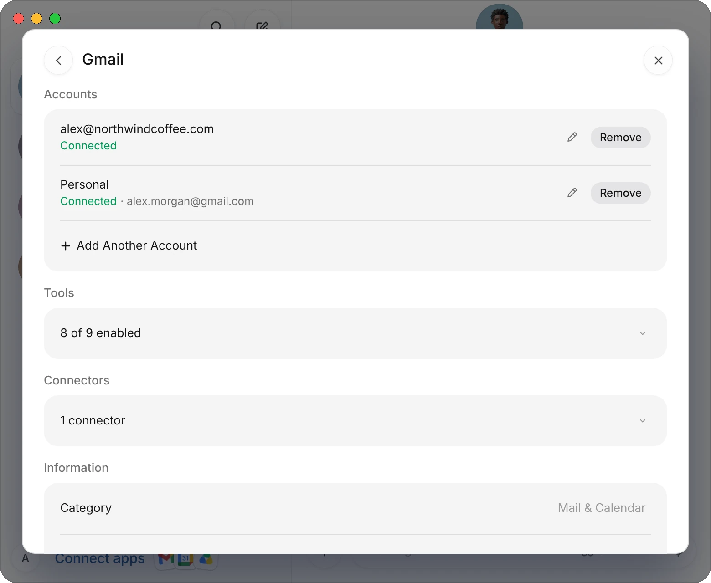
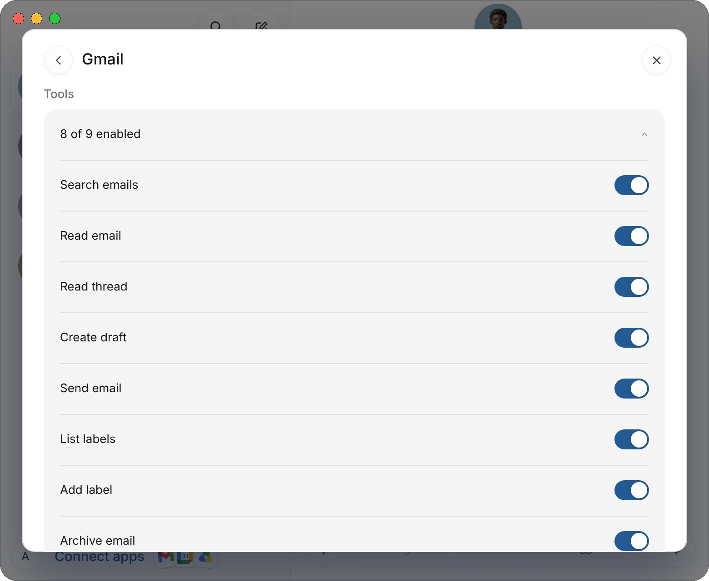

A connector lets your agents work inside one of your apps: read and draft email in Gmail, update records in HubSpot, file documents in Google Drive. You sign in once on the app's own page, and every agent on your team can use it.

This page covers how to connect an app, what your agents can do with it, and how to limit or remove that access. To see every app, browse the [connector directory](/connectors).

| Where | What you do there |
|---|---|
| **Connect apps**, at the bottom of your list of chats | Browse and connect apps, see the ones you've connected, and open each app's page. On iPhone, it's in **Settings**. |
| **A card in an agent's chat** | Connect an app the agent needs for the task you gave it. |
| **An app's page** | Add another account, turn tools off, or uninstall the app. |

## Connect an app

1. Choose **Connect apps** at the bottom of your list of chats. The **Connectors** window opens on **Available**.
2. Find the app. Type its name in **Search connectors**, or pick a group from **All Categories**, such as **Finance & Money** or **Mail & Calendar**. Choose a group's name to see all of its apps.
3. Choose **+** beside the app.
4. A sheet says what your agents will be able to do in the app and who handles the sign-in. Read it, then choose **Connect**.
5. The app's own sign-in page opens. Sign in and allow access.
6. Back in Simeon, the **+** turns into a green tick. The app is connected.

{c=#89acbc}

You never type a password or an API key into Simeon. If you close the sign-in page before you finish, nothing is left half-connected: the app goes back to **+**.

:::note
On the Mac and iPhone, the sign-in page opens in a sheet inside Simeon. In the web app, it opens in a new browser tab; in the Windows app, in your default browser.
:::

### What the sheet tells you

The sheet that opens before the sign-in is the same for every app:

{c=#8f7f8d}

| Part | What it says |
|---|---|
| **What it does** | What your agents can read and use in the app, such as your books, invoices, bills and expenses in QuickBooks. |
| **Control** | Steps that look risky wait for your OK, and you can turn off any of the app's tools or remove it. |
| **Check their work** | Look over what your agents do in the app, especially at first. |
| The lines at the foot | Who runs the sign-in, and that what your agents read in the app becomes part of your chats with them. |

For apps that move money, the sheet also reminds you that what happens there is real.

## Connect an app from the chat

You don't have to connect everything up front. Give an agent a task, and if it needs an app you haven't connected, it says so and shows a card with the app and its reason.

> Can you match last month's Stripe payouts against our invoices and tell me what's missing?

{c=#8f7f8d}

1. Choose **Connect** on the card.
2. Read the sheet and choose **Connect**, then sign in on the app's page.
3. When the card says **Connected**, tell the agent to go on:

> Done, it's connected.

When an app has a connector, agents ask you to connect it rather than going to the website. An agent never connects an app you haven't asked for or approved on a card.

:::tip
You can also ask for an app by name: "Connect Notion so you can keep our meeting notes there." The agent shows the card, and you sign in.
:::

## See the apps you've connected

In the **Connectors** window, choose **Yours**. **Installed** lists every app you've connected, each with a green tick. Choose an app to open its page.

{c=#89acbc}

**Yours** also lists, under **Private**, the skills of the agent whose chat is open. See [Skills](/docs/routines#skills).

## Add another account

Some apps, such as Gmail, Outlook and Slack, can be connected more than once: a work and a personal mailbox, or two Slack workspaces.

1. Open the app's page from **Yours**.
2. Under **Accounts**, choose **Add Another Account**, and sign in with the other account.
3. To tell them apart, choose the pencil beside an account and give it a name, such as Personal.

{c=#89acbc}

You can connect up to five accounts of one app. With more than one, say which account to use in your message ("from my personal Gmail"); if you don't, the agent asks. **Remove** beside an account disconnects that account only.

## Choose which tools agents can use

Each app gives your agents a set of tools, one for each thing they can do in it, such as searching email, writing a draft or sending. You can turn off the ones you don't want any agent to use.

1. Open the app's page from **Yours**.
2. Under **Tools**, open the line that says how many are enabled, such as **9 of 9 enabled**. Each tool has a switch.
3. Turn off the switch beside a tool.

{c=#89acbc}

The change applies to every agent at once. Turn the switch back on to give the tool back.

:::tip
Turning off a tool is the surest way to keep agents from an action. For example, turn off Gmail's tool for sending email if you want every email left as a draft for you.
:::

## Disconnect an app

1. Open the app's page from **Yours**.
2. At the foot of the page, choose **Uninstall**.

The app is removed right away, without a question, and your agents can no longer use it. To use it again, connect it again. To disconnect one account of an app and keep the others, use **Remove** beside that account instead.

## Apps that pay for things

Two connectors let an agent buy what you ask for:

- **Link**, by Stripe: pays with a one-time card, never your real one, and nothing is paid until you approve the purchase in the Link app. It can also read the bank accounts you choose to share with Link, to answer questions about your spending. US only.
- **Shop**, by Shopify: finds products across Shopify stores, pays with your Shop card, and tracks your orders.

Before anything is paid, a checkout card appears in the chat with **Allow** and **Deny**. See [Approvals, security, and privacy](/docs/approvals).

## Add your own MCP server

If you or your developers run an MCP server, an agent can add it to your account. Give the agent the server's web address:

> Add our MCP server at https://mcp.northwindcoffee.com/mcp so you can read our stock levels.

The agent asks you to confirm before it adds the server. If the server has its own sign-in, a Connect card appears in the chat. Only servers reached by a web address can be added. Don't paste API keys or tokens into the chat.

## Common questions

### Do all my agents get the app?

Yes. A connected app belongs to your account, so every agent on your team can use it. To keep agents from an action, turn off that tool on the app's page.

### Can an agent send or delete things without asking me?

An email or a Slack message that would go out under your name comes to you as a draft card first, unless you asked the agent to send it. Steps that look risky wait for your OK. To rule an action out completely, turn off its tool. See [Approvals, security, and privacy](/docs/approvals).

### An app says Coming soon. Why?

Some apps are listed before they can be connected. They show **Coming soon** in place of **+** until their sign-in works.

### Why can't I connect Canva or Dropbox in my browser?

A few apps, including Canva, Dropbox, Square and Vercel, only send their sign-in back to an app installed on your computer. Connect them from the Mac, iPhone or Windows app; once connected, they work everywhere.

### What if the app I need isn't listed?

Agents can still use most websites in the browser on [their computer](/docs/computer). A connector is faster and more reliable, so use one when it exists.

## Related pages

:::cards
- [Connector directory](/connectors) Every app you can connect.
- [Approvals, security, and privacy](/docs/approvals) What waits for your OK.
- [Routines and skills](/docs/routines) Run work in your apps on a schedule.
- [Credentials Store](/docs/credentials) Logins for sites without a connector.
:::
