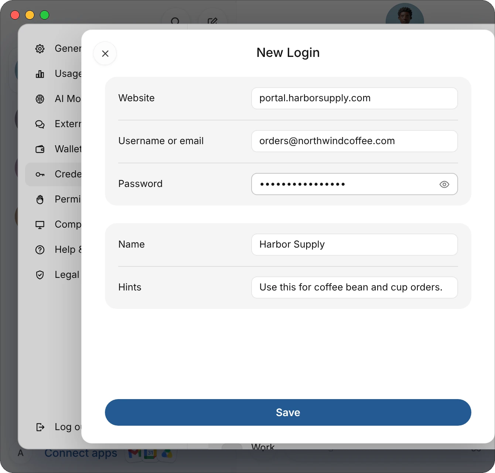
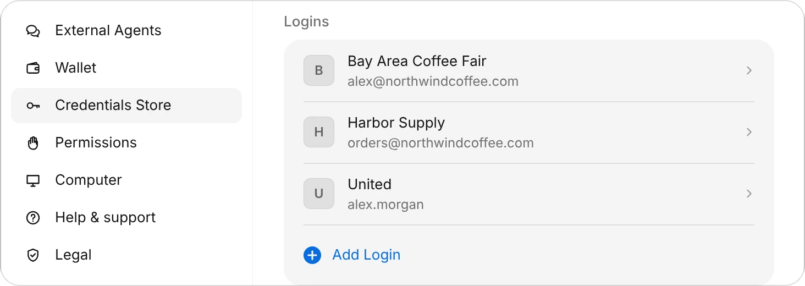
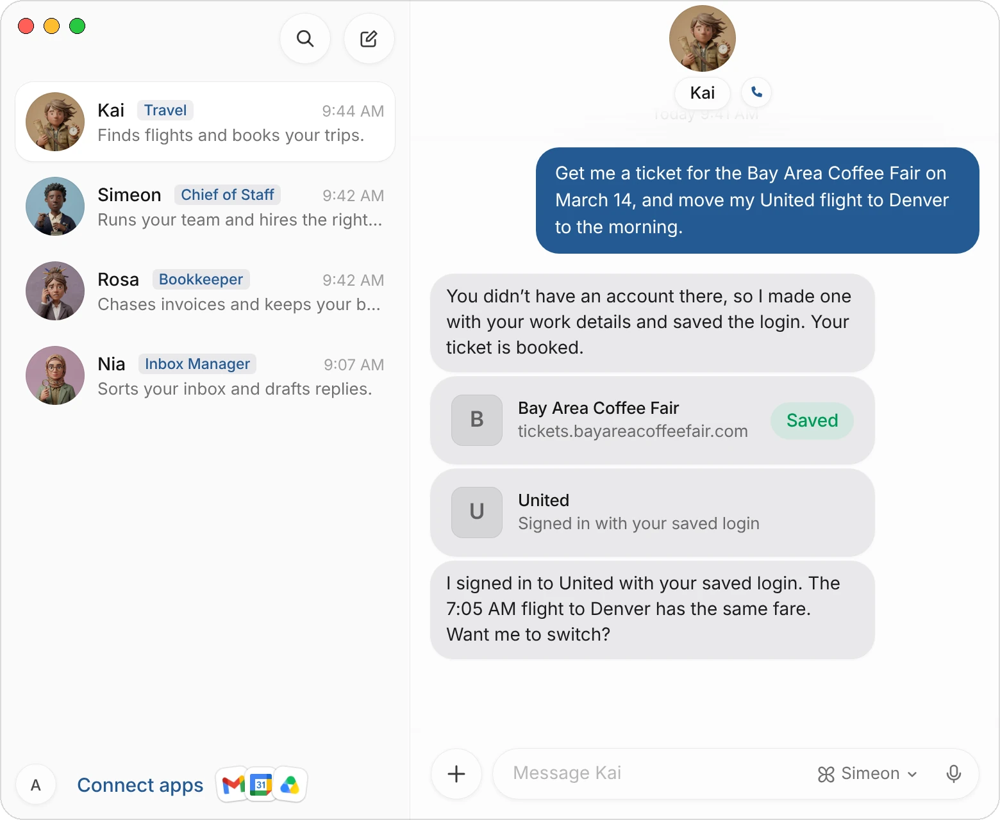
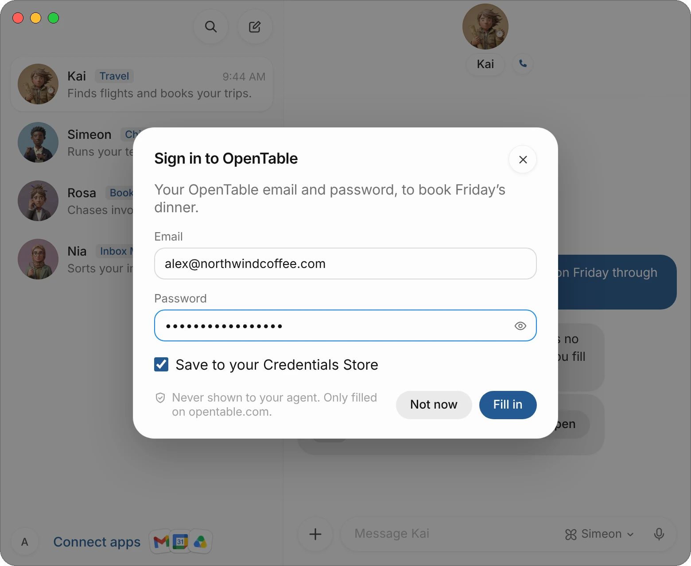

The Credentials Store keeps the logins and contact info your agents need to sign in to websites and fill in forms for you. You save them once, in the app; your agents never ask for a password in the chat.

This page covers what you can save, how agents use it at a sign-in or a sign-up, and what happens when a site needs something you haven't saved.

| What you save | What it holds | What agents use it for |
|---|---|---|
| **Logins** | A website, a username or email, a password, a name and hints. | Signing in to that site on their computer. |
| **Contact info** | Your full name, email, phone and address, with a name such as Work or Home. | Filling in forms, bookings and sign-ups. |

Your entries are kept encrypted on Simeon's server, not on the agents' computer, so agents can use them while your Mac is closed.

## Save a login

1. Open **Settings** and choose **Credentials Store**.
2. Under **Logins**, choose **Add Login**.
3. Fill in the **Website**, such as harborsupply.com, the **Username or email** and the **Password**.
4. Give it a **Name** you'll recognise, and add **Hints** if it helps: when to use this login, or which account it is.
5. Choose **Save**.

{c=#89acbc ar=4/3}

The login appears in the list with its site's icon. An agent uses it only on the website it's saved for, or a part of that site such as portal.harborsupply.com.

{c=#89acbc edge=right ar=5/2}

:::tip
Use **Hints** when you have more than one login for a site, or when the name doesn't say what it's for: "My MileagePlus account. Use it for every United booking."
:::

## Save your contact info

1. In **Credentials Store**, under **Contact info**, choose **Add Contact Info**.
2. Fill in what you'd like agents to use: **Full name**, **Email**, **Phone** and an **Address**.
3. Give it a **Name**, such as Work or Home, and choose **Save**.

Save one entry for each set of details you use, such as your work and home addresses. Add a hint to say which one to use where: "Use for anything shipped to the café."

## Change or delete an entry

Choose an entry in the list to open it. Change any field, then choose **Save**. To remove it, choose **Delete Login** or **Delete Contact Info** at the foot, and confirm.

A saved password stays hidden. To see it, choose the eye beside it and confirm it's you: with Face ID or Touch ID on a Mac or iPhone, or Windows Hello in the Windows app.

## How agents sign in

When an agent reaches a sign-in page on its computer, it looks in your Credentials Store first.

- **You've saved a login for the site:** the computer types the username and password into the page. You don't need to do anything. The agent tells you which login it used, and a note in the chat says **Signed in with your saved login**.
- **It's a sign-up:** the agent fills in the form with your contact info, makes a strong password, types it in and saves the new login in your Credentials Store. A note in the chat says **Saved**, and the login shows **Saved by** and the agent's name.

> Get me a ticket for the Bay Area Coffee Fair on March 14, and move my United flight to Denver to the morning.

{c=#a5835f}

The computer types the password into the page, so the agent doesn't see it. An agent reads a saved password only for a sign-in the computer can't fill, such as a desktop app, and only for the site it's saved for.

## When a login isn't saved

If a site needs a login you haven't saved, the agent asks you to fill it in with a secure form. You type it in the form, never in the chat.

1. A card in the chat says **Sign in to** and the site's name, with **Opens a secure form**. Choose **Open**.
2. Type your email or username and your password. Choose the eye to check the password.
3. Leave **Save to your Credentials Store** ticked to keep the login for next time.
4. Choose **Fill in**. The computer types it into the page, and the card says which fields went in.

{c=#a5835f}

What you type in the form goes only into the page on that site. It isn't shown to the agent or kept in the chat. Choose **Not now** to decline; the agent hears that you said no.

Agents use the same form for other things a page needs from you, such as a one-time code sent to your phone. A code or a password is always hidden as you type.

:::note
Some sign-ins can't be filled in a form: signing in with Google or Microsoft, a passkey, or a captcha. For those, the agent asks you to take over its computer for a moment. See [The agent's computer](/docs/computer).
:::

### When the agent offers to save something

When a task needed something that isn't saved, such as your contact info for a booking, the agent may offer to keep it with a card in the chat. Choose **Add** on the card: the Credentials Store's own form opens over the chat, its name already filled in. For a login, the card is the **Sign in to** card above, and what you type in its form is saved in the store. Once you save, the card says **Saved** and the agent carries on.

## 1Password

If you keep your logins in 1Password, your agents can use them too.

1. Tell an agent you use 1Password, or ask it to connect it.
2. The agent shows a card. Connect from the Simeon app on your Mac: your 1Password app asks for Touch ID, then makes a vault called **Shared with Simeon** and a key that can only read that vault.
3. In 1Password, put the logins your agents may use in **Shared with Simeon**.

At a sign-in, agents look in your Credentials Store first, then in that vault. When a login is there, a card asks **Fill with 1Password**. Confirm with Face ID or Touch ID, and the computer types the username, the password and, when the login has one, its one-time code. The agent never sees them.

Agents only see the vault you shared, never the rest of your 1Password. To disconnect, delete the Simeon service account in 1Password.

## What agents can and can't see

| Agents can | Agents can't |
|---|---|
| See each login's website, username, name and hints. | Ask you for a password in the chat. |
| See your contact info and use it in forms. | See what you type in the secure form. |
| Have the computer type a saved login into its site. | Use a login on a site other than its own. |
| Save a new login after a sign-up. | Delete an entry. Only you can, in the app. |

:::warning
Agents don't use the Credentials Store when a message reaches them through Slack or another chat app, where other people can write to them. They use it only in your own chats with them.
:::

## Common questions

### Should I give an agent a password in the chat?

No. Save it in the Credentials Store, or type it in the secure form when the agent asks. Both keep the password out of the chat and away from the agent.

### Is the Credentials Store the same on my Mac and iPhone?

Yes. Your entries are kept on Simeon's server, so the Mac, iPhone, web and Windows apps all show the same ones, and your agents use them from any device.

### What happens to my entries if I delete my account?

They're deleted with it.

## Related pages

:::cards
- [The agent's computer](/docs/computer) Watch a sign-in, or take control.
- [Connect apps](/docs/connectors) Apps that sign in once, with no password to save.
- [Approvals, security, and privacy](/docs/approvals) What waits for your OK.
- [Create and manage agents](/docs/agents) Give each agent its job.
:::
