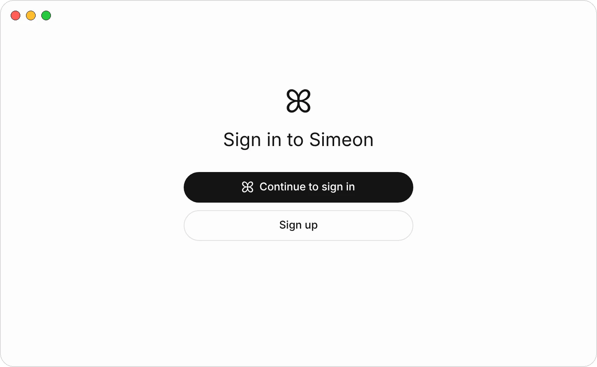
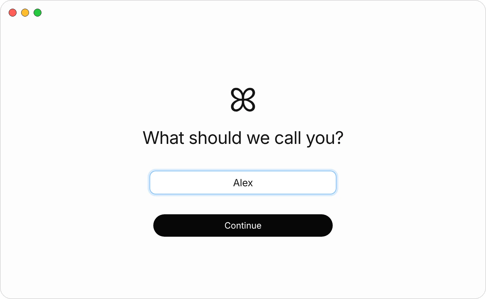
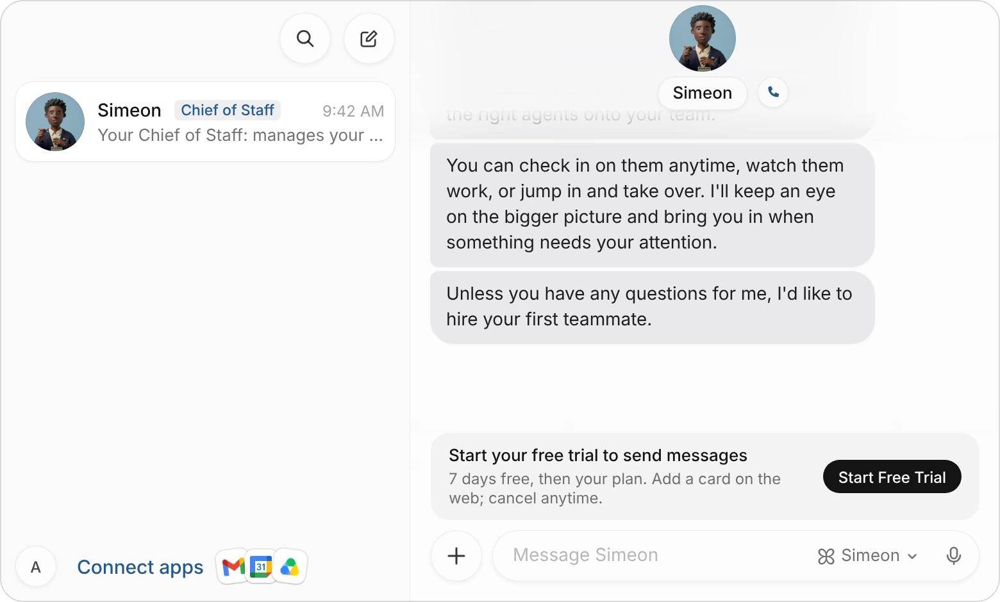
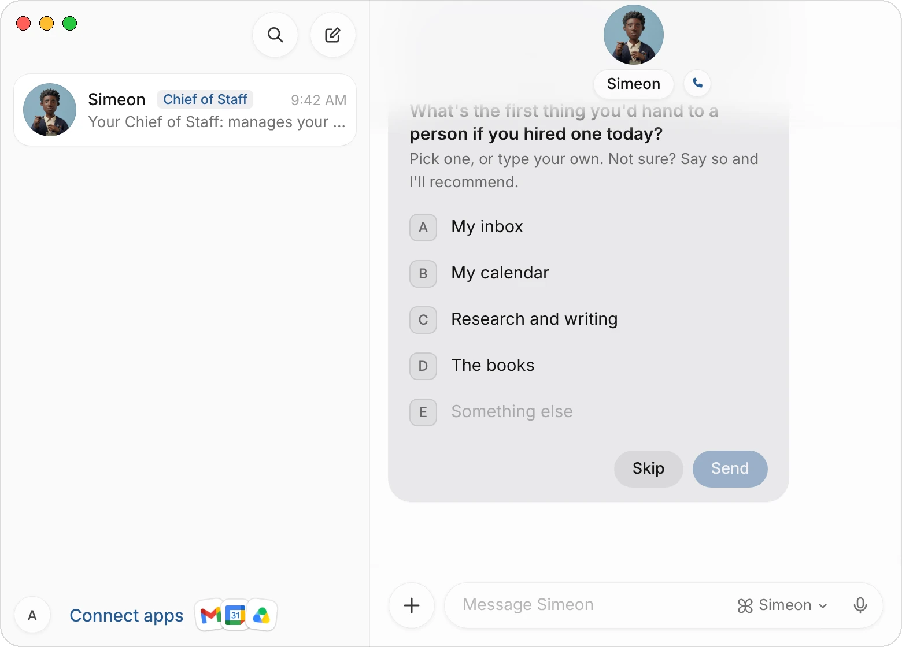
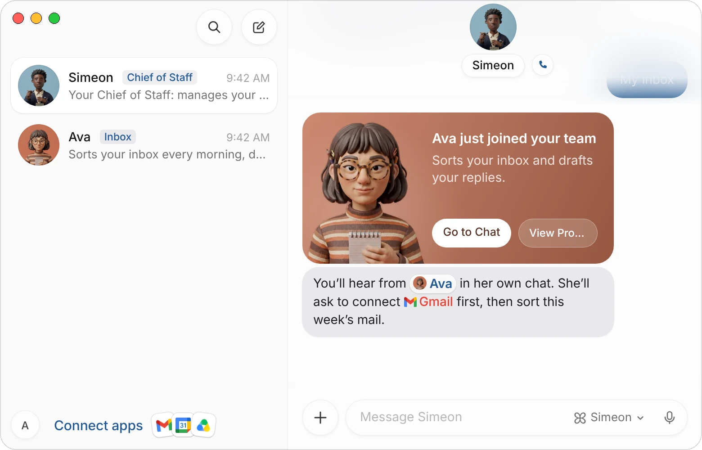
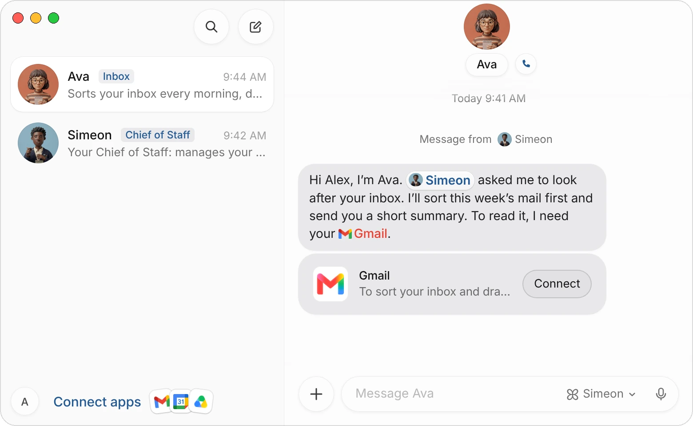
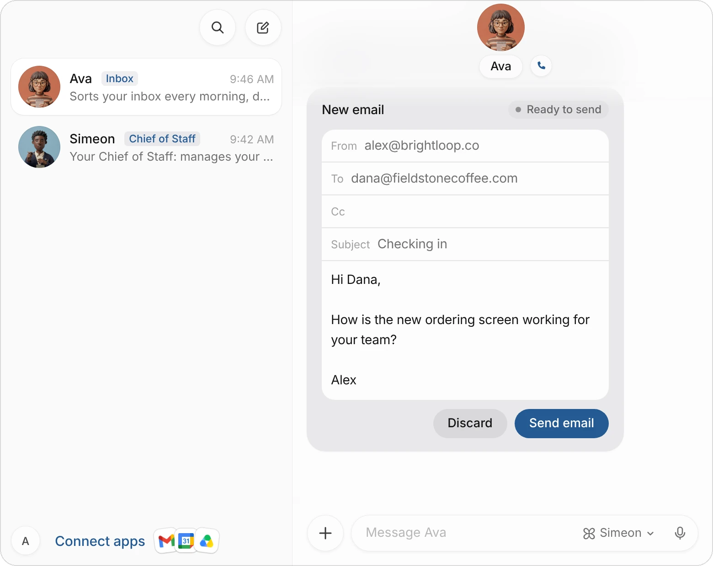

This guide takes you from the download to your first finished task. You'll install the app, sign in, meet Simeon, let him hire your first agent, connect the app it needs and check its work.

| You need | Details |
|---|---|
| **A Mac or a Windows PC** | A Mac with Apple silicon on macOS 15 or later, or a PC with Windows 10 or 11. |
| **An email address** | Or a Google or Apple account to sign in with. |
| **A card, for the trial** | Every plan starts with a 7-day free trial. You add a card on the web and can cancel at any time. See [Plans and billing](/docs/billing). |

## 1. Install the app

**On a Mac:**

1. [Download Simeon for macOS](https://api.simeonlabs.com/desktop/download/mac).
2. Open the downloaded file and drag **Simeon** into your **Applications** folder.
3. Open Simeon from Applications or Spotlight.

Simeon updates itself. You can check for an update in **Settings** › **Updates**.

**On a Windows PC:**

1. Open [Simeon in the Microsoft Store](https://apps.microsoft.com/detail/9P588HGXP209) and install it from there.
2. Open Simeon from the Start menu.

The Microsoft Store keeps Simeon up to date.

The rest of this guide shows the Mac app. The Windows app follows the same steps.

## 2. Sign in

{c=#89acbc ar=16/11}

1. Choose **Continue to sign in**, or **Sign up** if you don't have an account yet. Your browser opens, and the app says **Continue in your browser**.
2. In the browser, type your email and choose **Continue**, then type the six-character code we email you. Or choose **Continue with Google** or **Continue with Apple**.
3. The page asks you to confirm the account: choose **Continue as** with your email, or **Use a different account**.
4. The page says **You're signed in to Simeon**. Go back to the app; it carries on by itself.

If you closed the browser tab, choose **Reopen link** in the app. **Cancel** takes you back to the first screen.

## 3. Tell Simeon your name

While the app sets up your agents' computer, it asks one question: **What should we call you?** Your first name from Google or Apple is already filled in when there is one.

{c=#89acbc ar=16/11}

Type the name your agents should use and choose **Continue**. Your chat with Simeon opens; if his computer is still starting, the app says **Getting your team ready…** first. You can change your name later in **Settings** › **General** › **Simeon Account**.

:::note
The Mac asks whether Simeon can send you notifications. Allow them, so you know when an agent finishes a task or needs your answer.
:::

## 4. Start your free trial

If your account has no plan yet, the bottom of the chat says **Start your free trial to send messages**, and sending waits until you start it.

{c=#89acbc edge=right ar=3/2}

1. Choose **Start Free Trial**. The plans page opens in your browser.
2. Choose a plan and add a card. You aren't charged during the 7 days, and you can cancel before they end.
3. Go back to the app. Once the trial has started, the notice goes away and you can send messages.

## 5. Meet Simeon and hire your first agent

Simeon is your chief of staff. His job is to build your team: he hires agents, briefs them and passes work to them. He introduces himself in four short messages, then asks what you'd hand off first:

{c=#89acbc ar=4/3}

1. Choose the job you'd hand off first, such as **My inbox**. Your answer is sent as soon as you choose it. If the job isn't on the list, choose **Something else**, describe it in your own words and choose **Send**:

> Chase the invoices clients haven't paid and keep our books up to date.

2. If the job isn't clear yet, Simeon asks one or two more questions. If you're not sure what to hand off, tell him so and he recommends a first hire and says why.
3. Simeon hires the agent. A card says it **just joined your team**, and Simeon says what it will do first.

{c=#c47256 ar=16/11}

The new agent has a first name, a title that names the job, a description and a brief from Simeon that tells it what to do first. Simeon then asks whether there's anything else you'd hand off today. Pick another job, or choose **That's all for now**.

:::tip
For a bigger project, describe the project instead of one job. Simeon says who he'd hire, up to three agents for a first team, and hires each one. See [Ask for a whole team](/docs/agents#ask-for-a-whole-team).
:::

## 6. Connect the app your agent needs

Choose **Go to Chat** on the card, or choose the new agent in your list of chats. At the top of its chat is **Message from Simeon**: the brief he sent it. Choose it to read the brief.

The agent introduces itself and asks for the app it needs, with a card:

{c=#c47256 ar=16/11}

1. Choose **Connect** on the card. A window says what the app lets your agents do.
2. Choose **Connect** again. The app's own sign-in page opens in your browser.
3. Sign in and allow access. The page says **Connected**; close the tab and go back to Simeon.

The agent picks up where it stopped. Simeon never sees your password for the app. To connect apps ahead of time, choose **Connect apps** at the bottom of your list of chats; see [Connect apps](/docs/connectors).

## 7. Give it a first task

The agent starts on Simeon's brief right away. To give it something specific, write in its chat, or choose the microphone and dictate. A good first task is real, spans a few steps, and says where the agent should stop and check with you:

> Find the five customers we haven't heard from in a month and draft a short check-in for each, in my voice. Show me the drafts before anything is sent.

| A good request says | For example |
|---|---|
| What you want done | Find five quiet customers and draft a check-in for each. |
| Where to look | In my Gmail, from the last month. |
| What you want back | One draft per customer. |
| Where to stop | Show me the drafts before anything is sent. |

## 8. Check the result

The agent reports in its chat as it goes. An email in your name comes as a draft card:

{c=#c47256 edge=right ar=5/4}

1. Read the draft. To change it, edit the text on the card, or tell the agent what to change.
2. Choose **Send email** to send it, or **Discard** to drop it. Nothing is sent until you choose **Send email**.
3. Tell the agent what to keep doing differently, the way you would a colleague:

> Good. Keep them shorter, and sign them "Alex" without "Best".

Ask it to remember this, and it will for the next tasks. When a task goes well, ask the agent to do it on a schedule, such as every Monday morning; see [Routines](/docs/routines).

## Use Simeon on your iPhone

Simeon for iPhone shows the same agents and chats. Sign in with the same account to message and call your agents, answer their cards and watch their computers. See [Simeon for iPhone](/docs/iphone).

## Common questions

### Simeon says he couldn't finish setting up. What do I do?

Choose **Try again**. If it keeps failing, check your internet connection, then quit and reopen the app.

### I closed the browser before signing in. How do I finish?

Choose **Reopen link** in the app to open the sign-in page again, or **Cancel** and start over with **Continue to sign in**.

### Do I have to hire through Simeon?

No. You can create an agent yourself with the **New Agent** button at the top of your list of chats, or add a ready-made team of five from the [Marketplace](/marketplace). See [Create an agent yourself](/docs/agents#create-an-agent-yourself) and [Use cases](/docs/use-cases).

### Can I skip connecting an app?

Yes. The agent can't work in that app until it's connected, but it can still use websites in the browser on its computer. Connect the app later from **Connect apps** at the bottom of your list of chats.

## Related pages

:::cards
- [Create and manage agents](/docs/agents) Hire agents, set their jobs and manage your team.
- [Connect apps](/docs/connectors) Give your agents the apps they need.
- [Use cases](/docs/use-cases) Ready-made teams and first tasks you can copy.
- [Plans and billing](/docs/billing) Plans, the free trial and extra credits.
:::
