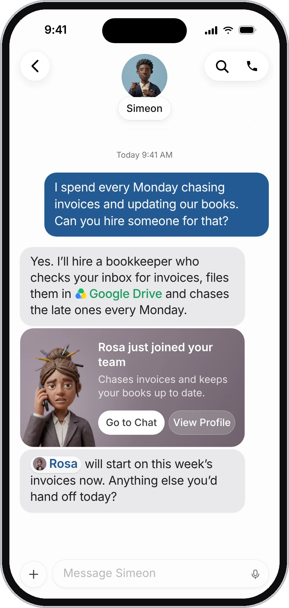
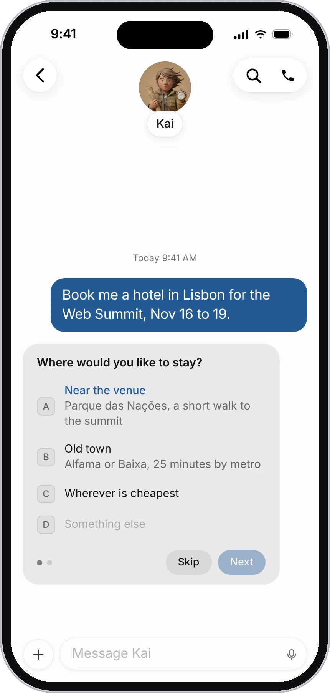
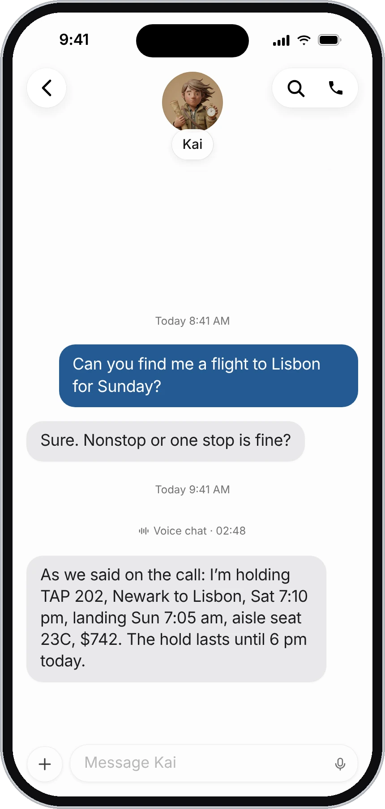

Simeon for iPhone works with the same agents, chats and cloud computer as Simeon on your Mac. Sign in with the same account and everything is there: a message you send on your iPhone shows on your Mac, and the other way round. Your agents keep working whether the app is open or not.

This page covers setting up the app and what's different on a phone.

:::note
Simeon for iPhone isn't in the App Store yet. When it is, you'll find the download on [simeonlabs.com](/).
:::

| On your iPhone you can | |
|---|---|
| **Message your agents** | Type or dictate, and send photos, files and videos. |
| **Call an agent** | Talk to it out loud while it works. |
| **Answer its cards** | Questions, drafts, approvals and sign-in forms, as on the Mac. |
| **Get notified** | When an agent finishes or needs you, with your Mac open or closed. |
| **Use its computer** | Watch the agent's screen, or take control with your fingers. |
| **Manage your team** | Hire and create agents, edit profiles, connect apps. |

## Set up the app

1. Open Simeon and sign in with the same account you use on your Mac: **Continue with Apple**, **Continue with Google**, or your email.
2. If your iPhone has Face ID, Simeon offers to lock the app with it. You can change this later in **Settings**.
3. Allow notifications, so you hear when an agent finishes or needs you.

Your list of chats opens. Choose an agent to open its chat.

## Message an agent

Messaging works as on the Mac: write in the field at the bottom and send. See [Message and call your agents](/docs/messaging).

{c=#89acbc w=46 ar=16/13}

- **Attach something:** tap **+** and choose **Photo or Video**, **Take Photo**, **Choose File** or **Paste Picture**.
- **Dictate:** tap the microphone in the message field, speak, then tap to stop. Check the words, then send.
- **React, reply or start a thread:** touch and hold a message.
- **Mention an agent:** type @ and choose it from the list.
- **Find in the chat:** tap the magnifying glass at the top.

## Answer questions and cards

Every card an agent sends on the Mac also works on iPhone: questions, email and Slack drafts, approvals, secure sign-in forms and requests to use the computer. Tap the answer, the button or the form, the same way.

{c=#a5835f edge=right w=46 ar=21/20}

So an agent doesn't wait for you to get back to your desk: if it needs a decision, you get a notification, and you answer from the card.

## Notifications

Your iPhone gets a notification when an agent finishes a task or needs you, whether your Mac is open or closed. It shows the agent's name and its last message, or what it needs. Tap it to open that agent's chat.

You don't get a notification for the chat you're reading.

| To | Do this |
|---|---|
| Turn off notifications from one agent | Touch and hold its chat in the list and choose **Hide Alerts**, or turn off **Notifications** in its profile. |
| Turn off all notifications on this iPhone | **Settings** › **Notifications**. |

## Call an agent

1. Open the agent's chat.
2. Tap the phone at the top right.
3. Talk. The call shows as a bar in the chat with **Mute**, **Transcript** and the red **End**. Tap the bar for the full screen.

You can keep reading and writing in the chat during the call. When you hang up, the call stays in the chat as a line with its length; tap it to read what you both said.

{c=#a5835f w=46 ar=11/10}

## Watch or take over the computer

On iPhone the agent's computer opens as a sheet that fills the screen.

1. Open the agent's profile: tap its face at the top of its chat.
2. Tap the screen icon for the **Computer** tab, then tap the screen.

It also opens when you tap **Take over** on a card where the agent needs you. Then it opens with you already in control.

| Control | What it does |
|---|---|
| **Watching**, **Take control** | The switch under the title. **Take control** pauses the agent if it's working; **Watching** lets it carry on. |
| **Stop task** | At the bottom while the agent works: stops the agent and anything it started, until you write to it again. |
| **Skip step** | When the agent asked for your help: declines the step. |
| **✓** | Hands the computer back to the agent and closes the sheet. |
| **Clipboard** | At the top left: **Paste from Phone** or **Copy to Phone**. |

### Use the screen with your fingers

| Gesture | Watching | In control |
|---|---|---|
| Pinch | Zooms in, up to four times. | Zooms in. |
| Double tap | Zooms in on that spot, or back out. | |
| One finger | Moves the zoomed picture. | A tap is a click; a drag scrolls the page. |
| Touch, hold, then drag | | Holds the mouse button down, to select text or move a slider. |

In control, tapping a text field on the page brings up your keyboard, of the right kind for the field (an email, a number, a password). Tap elsewhere to put it away. Return presses Enter on the computer.

:::tip
For a sign-in or a code, an agent usually sends a secure form in the chat instead of handing you the computer. Typing in the form is easier on a phone than on the remote screen. See [The agent's computer](/docs/computer#type-a-sign-in-or-a-code-in-a-secure-form).
:::

## Settings on iPhone

Tap your picture or initials at the top left of your list of chats to open **Settings**.

| Setting | What it does |
|---|---|
| **Notifications** | Turns notifications on or off for this iPhone. |
| **Face ID** | Asks for Face ID when Simeon opens, and when you come back after 15 minutes away. Only on this iPhone. |
| **Appearance** | System, Light or Dark. |
| **Language** | The app's language. Close and reopen Simeon to use it. |
| **Haptics** | Taps you feel on buttons, clicks and the computer. |
| **Connect apps** | The same apps as on the Mac. An app you connect on one works on both. |
| **Credentials Store** | Logins, cards and contact details your agents can fill in. See [Credentials Store](/docs/credentials). |

## Plans on iPhone

On iPhone, plans are bought through the App Store, and billed by Apple each month. To change or cancel, open your iPhone's **Settings**, tap your name, then **Subscriptions**. See [Plans and billing](/docs/billing).

## Requirements

An iPhone with iOS 26 or later.

## Common questions

### Do my agents stop when I close the app?

No. They run on your cloud computer, not on your phone. Close the app, lock your phone or switch it off: they carry on, and you get a notification when one finishes or needs you.

### Can I use my iPhone and my Mac at the same time?

Yes. They show the same chats. A message sent from one shows on the other.

### Can I create agents on iPhone?

Yes. Tap the compose button at the top of your list for **New Agent**, or ask Simeon to hire one. See [Create and manage agents](/docs/agents).

### Why can't I swipe the computer away?

While you're in control, the sheet stays open so you don't close it by accident. Tap **✓** to hand the computer back, or switch to **Watching** first.

## Related pages

:::cards
- [Message and call your agents](/docs/messaging) Chat, voice calls, files and drafts.
- [The agent's computer](/docs/computer) Watch an agent work, or take control.
- [Approvals, security, and privacy](/docs/approvals) The cards agents use to ask you first.
- [Plans and billing](/docs/billing) Plans, usage and how to cancel.
:::
