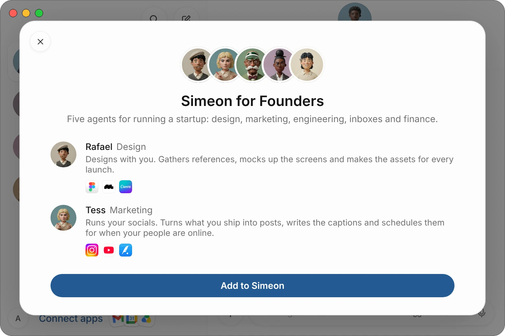
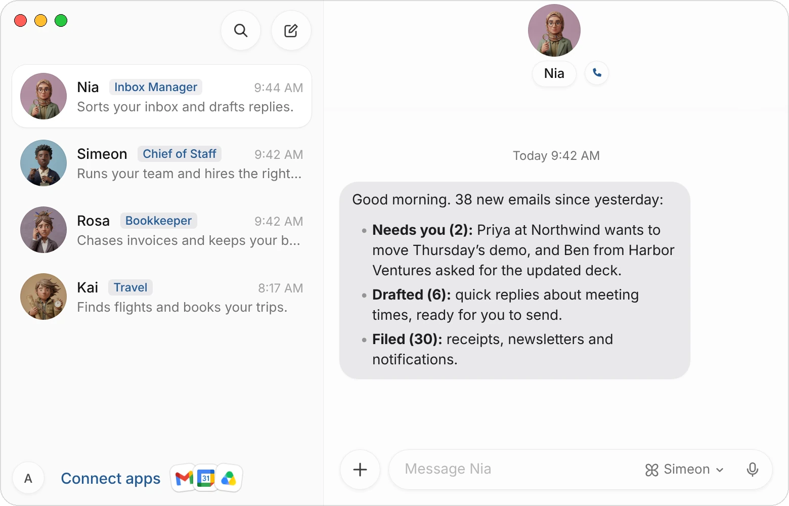
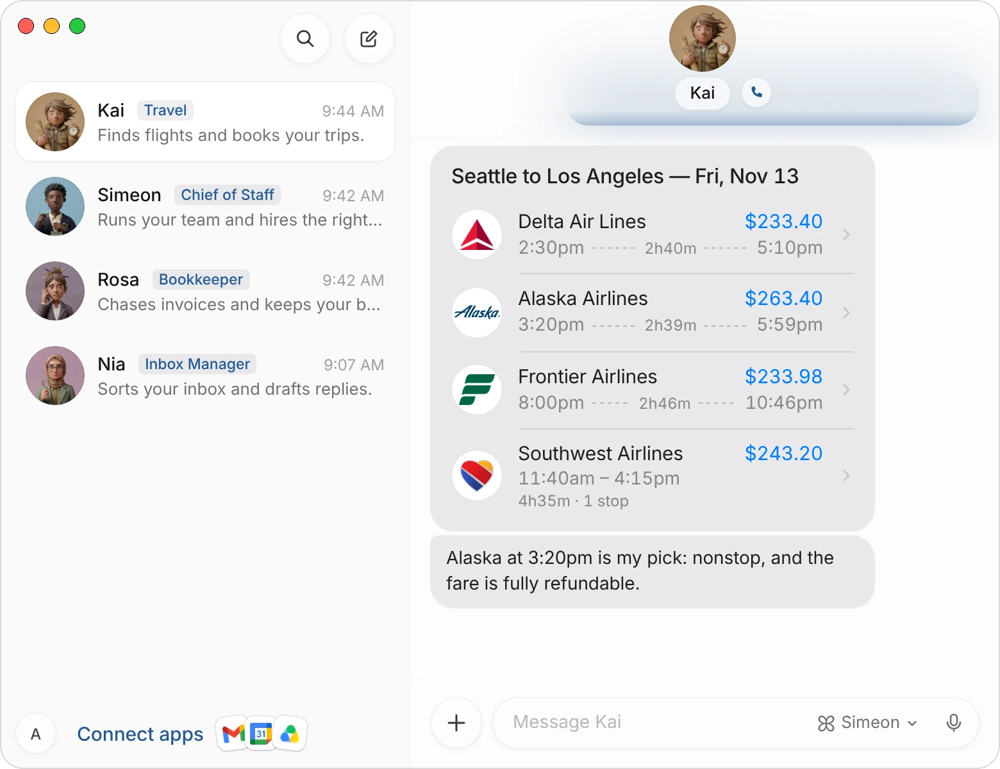

Simeon works best when each agent has one clear job. There are two ways to build a team around your work: add a ready-made team of five from the [Marketplace](/marketplace), or ask Simeon to hire for one job at a time.

This page covers both, with first tasks for the jobs people hand off most, and how to write a request an agent can finish.

## Add a ready-made team

Each team in the Marketplace has five agents for one kind of work, already named, each with a face, a job, instructions and the three apps it asks to connect. Adding a team is free.

1. Open the [Marketplace](/marketplace) and choose a team.
2. Choose **Add to Simeon**. The Simeon app opens and shows the team: each agent, what it does and the apps it uses.
3. Choose **Add to Simeon** in the app.

{c=#89acbc ar=7/5}

The five agents appear together in your list of chats, in a folder named after the team, such as **Founder Team**, and the first one's chat opens. Each agent sends you a first message right away: it names the apps it needs, with a **Connect** card for each one you haven't connected yet, and asks what to start on.

| Team | Agents |
|---|---|
| [Coffee Shops](/marketplace/coffee-shop/) | Bruno (Stock), Clara (Shifts), Mae (Socials), Ines (Customers), Hugo (Money) |
| [Founders](/marketplace/founders/) | Rafael (Design), Tess (Marketing), Otis (Engineering), Margot (Inboxes), Arlo (Finance) |
| [Agencies](/marketplace/agencies/) | Isla (Projects), Ravi (Reporting), Jonas (New business), Nadia (Clients), Camille (Billing) |
| [Real Estate Agents](/marketplace/real-estate/) | Nora (Leads), Felix (Listings), Ada (Showings), Owen (Deals), Lena (Market) |
| [Online Stores](/marketplace/online-stores/) | Gus (Orders), Pia (Support), Rafa (Products), Wren (Stock), Kai (Marketing) |
| [Freelancers](/marketplace/freelancers/) | Elsa (Inbox), Marco (Proposals), Talia (Invoices), Sam (Time), Lucia (Leads) |
| [Creators](/marketplace/creators/) | Milo (Ideas), Rosa (Scripts), Dex (Sponsors), Zoe (Community), Nico (Stats) |
| [Salespeople](/marketplace/sales/) | Ivy (Research), Omar (Outreach), Greta (CRM), Rory (Coaching), Petra (Pipeline) |
| [Recruiters](/marketplace/recruiters/) | Jonah (Sourcing), Esme (Screening), Paolo (Interviews), Freya (Candidates), Anton (Offers) |
| [Law Firms](/marketplace/law-firms/) | Maya (Intake), Ezra (Paralegal), Vera (Deadlines), Elias (Billing), Hana (Research) |
| [Accountants](/marketplace/accountants/) | Otto (Documents), Noor (Expenses), Arlo (Fees), Sofia (Deadlines), Ravi (Updates) |
| [Landlords](/marketplace/property/) | Dalia (Tenants), Bram (Repairs), Nadia (Rent), Cyrus (Leases), Tess (Vacancies) |
| [Contractors](/marketplace/trades/) | Wes (Quotes), Rita (Schedule), Hal (Supplies), Joan (Invoices), Max (Reviews) |
| [Salons and Spas](/marketplace/salons/) | Lola (Bookings), Remi (Reminders), Nell (Reviews), Kira (Socials), Dora (Win-back) |
| [Busy Professionals](/marketplace/life/) | Eva (Inbox), Jasper (Travel), Ruby (Errands), Victor (Money), Pippa (Family) |

A team is a starting point. Rename its agents, change their jobs in their profiles, or delete the ones you don't need; see [Edit an agent's profile](/docs/agents#edit-an-agents-profile).

:::note
A few apps the teams ask for can't be connected yet. Their card says **Coming soon**; the agent can still work in that app's website in its browser.
:::

## Hire for one job at a time

If no team fits, tell Simeon what's taking up your time, in a sentence. He hires an agent for it and briefs it. See [Hire an agent through Simeon](/docs/agents#hire-an-agent-through-simeon).

> I run a small design studio. I lose hours every week to client emails, invoices and booking calls. Who should I hire first?

Simeon recommends a first hire and says why. For a project, he proposes a small team, up to three agents to start.

## First tasks to try

Each of these is a first message for an agent with that job. Change the details to fit your work. The apps after each heading are the ones the agent would ask you to connect.

### Inbox (Gmail or Outlook)

> Every morning at 8, sort my inbox. Draft replies to anything that only needs a yes or a date, file receipts and newsletters, and send me a summary of what needs me.

{c=#af8fa0 ar=16/11}

Each reply comes as a draft card in the agent's chat. Read it, edit it if you like, and choose **Send email**. An agent sends an email without a card only when you've asked it, in the chat, to send that message to those people.

### Finance (QuickBooks, Stripe or Xero)

> Match October's Stripe payouts against our invoices in QuickBooks, chase any invoice more than 14 days late with a friendly reminder, and tell me where the money went.

### Travel

> Find me a flight from Seattle to LA tomorrow.

The agent answers with a card of up to four flights, its pick in one line, and a panel for each flight with the times, the stops, the bags and the refund terms.

{c=#a5835f ar=4/3}

Choose a flight to see its details, then **Book with Simeon** to book it. You fill in the traveller's details in a form, and nothing is paid until you allow the checkout.

### Calendar (Google Calendar or Outlook)

> Keep my mornings free for deep work. Move internal meetings to the afternoon, and send me a one-page brief before every call with someone outside the company.

### Social media (Instagram, LinkedIn, Canva)

> Turn what we shipped this week into three posts for Instagram and LinkedIn. Show me the drafts, and schedule the ones I approve for when our followers are online.

### Research

> Find the ten companies most likely to need what we sell, with the right person to contact at each and one line on why. Put it in a Google Sheet.

### Sales (HubSpot or Salesforce)

> After each sales call, update the deal in HubSpot, log the next step, and draft the follow-up email for me to send.

### Hiring

> Screen the new applicants for the designer role against the job description, and book a 30-minute call with the three best in my free slots next week.

## Write a request an agent can finish

| Say | For example |
|---|---|
| **What you want done** | Chase every invoice more than 14 days late. |
| **Where the work is** | In QuickBooks and my Gmail. |
| **What you want back** | A list of who you chased and how much is still out. |
| **Where to stop** | Show me each reminder before it goes out. |
| **When to do it again** | Every Monday at 9. |

:::tip
Correct the first results the way you would a new colleague, and ask the agent to remember how you like it done. Once a task comes back right, ask for it on a schedule and it becomes a [routine](/docs/routines).
:::

## Common questions

### Should I add a whole team or start with one agent?

Start with what takes the most of your time. If a team in the Marketplace matches your work, adding it gives you five agents briefed for it at once. If you only need one or two jobs done, hire through Simeon instead; you can add more agents at any time.

### Can I add the same team twice?

No. If the team's agents are still in your list, the app shows **Open** with the team's folder name instead of **Add to Simeon**, and opens them.

### Do the agents in a team work together?

Yes. Agents message each other to hand work on, and Simeon passes work to whichever agent's job it is. See [How agents work together](/docs/agents#how-agents-work-together).

### What if an agent needs an app I don't use?

Tell it which app you use instead, or that you'd rather it work in the website. Change its description so it remembers.

## Related pages

:::cards
- [Get started](/docs/get-started) Install the app, meet Simeon and give your first agent a task.
- [Create and manage agents](/docs/agents) Hire agents, set their jobs and manage your team.
- [Connect apps](/docs/connectors) Give your agents the apps they need.
- [Routines](/docs/routines) Work that runs on a schedule.
:::
